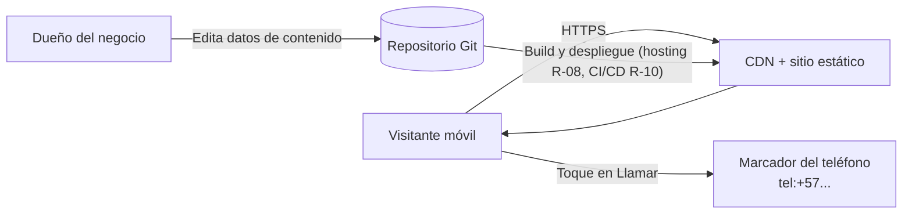
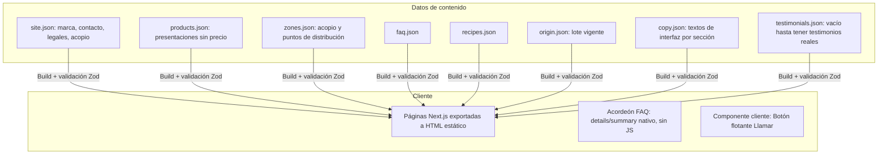
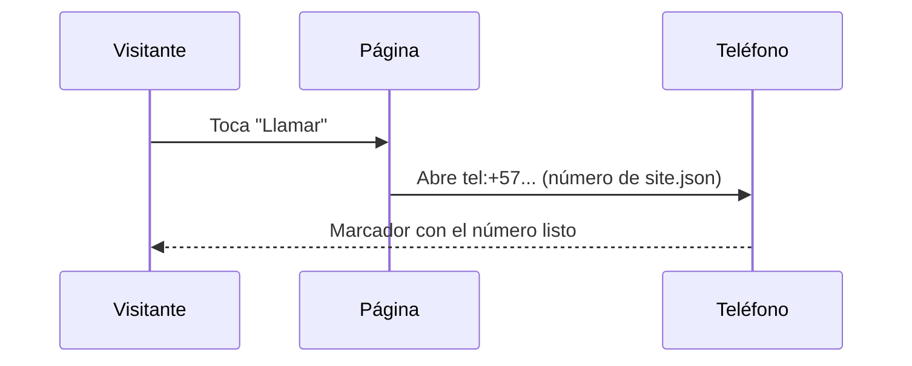

# Plan técnico: Landing Guineo Verde

**Versión:** 1.3 · **Fecha:** 2026-10-18 · **Estado:** Borrador · **Alcance vigente:** `05-alcance-y-roadmap.md` v1.3

## Índice
1. Contexto arquitectónico
2. Decisiones técnicas (comparativa y recomendación)
3. Arquitectura
4. Estructura del repositorio
5. Modelo de datos de contenido
6. Roadmap técnico (fuera de la Fase 1)
7. Seguridad (controles trazables)
8. Rendimiento y SEO
9. Analítica
10. CI/CD y entornos
11. Riesgos y hallazgos
12. Matriz de trazabilidad

---

## 1. Contexto arquitectónico
**Técnico:** sitio 100 % estático. **Sin backend en la Fase 1**: no hay función de servidor, formularios ni base de datos.
**Funcional:** landing informativa. El contacto es por llamada telefónica, con un enlace `tel:` generado desde un archivo de datos.



## 2. Decisiones técnicas

### D1. Framework

| Criterio | Astro | Next.js (SSG) | Angular SSR | Blazor WASM / SSR |
|---|---|---|---|---|
| JS enviado al cliente | Mínimo (islas) | Medio | Alto | Alto (WASM) o conexión persistente (SSR) |
| LCP en móvil 4G | Muy bueno | Bueno | Medio | Débil (WASM) |
| SEO estático | Excelente | Excelente | Bueno | Medio |
| Curva para tu perfil | Baja | Baja (ya usas React) | Nula (ya usas Angular) | Nula (.NET) |
| Idoneidad para landing | **Alta** | Media-alta | Baja | Baja |

**Decisión: Next.js (exportación estática) + React + TypeScript + Tailwind CSS.** Sin formularios en la Fase 1, el JavaScript en cliente se limita al botón flotante (el acordeón de FAQ usa `<details>` nativo, sin JavaScript). Alternativa descartada: Astro + React (islas), con menos JavaScript pero una herramienta nueva para el equipo.

### D2. Hosting

| Criterio | Azure Static Web Apps | Cloudflare Pages | Netlify |
|---|---|---|---|
| Familiaridad | **Alta (Azure)** | Media | Media |
| Plan gratuito | Sí, con límites a verificar | Sí, generoso | Sí, con límites |
| CDN | Global | Global, muy extensa | Global |
| Integración con Azure DevOps | Directa | Vía pipeline | Vía pipeline |

**Estado: pendiente de definir antes del primer despliegue (roadmap R-08).** Opción preferida hoy: Azure Static Web Apps, por afinidad con el stack. Alternativa: Cloudflare Pages. La decisión depende de medir latencia desde Colombia y de los límites vigentes del plan gratuito. No se elige hosting en esta versión del spec.

### D3. Analítica (roadmap R-07, fuera de Fase 1)
No se implementa en Fase 1. Cuando se active: **Plausible o Umami** (sin cookies) por defecto, lo que evita el banner de consentimiento. GA4 solo si se necesita integración con Google Ads, y entonces con banner de consentimiento.

### D4. Contacto y backend (diferido)
Fase 1: llamada telefónica (`tel:`). No hay backend. El formulario B2B, el endpoint `/api/b2b`, el anti-spam (Turnstile) y el almacenamiento de leads quedan en el roadmap R-06, y se decidirán cuando se active el formulario.

### D5. Pedido por WhatsApp y pedido en línea (roadmap)
- **R-02 WhatsApp Business:** cuando se active, enlace `wa.me` con mensaje prellenado. No se implementa en Fase 1.
- **R-04 Pedido en línea:** pasarela Wompi o PayU, carrito mínimo y backend de pedidos. No se implementa ahora.

## 3. Arquitectura



**Flujo del botón de llamada**



## 4. Estructura del repositorio

```
landing-guineo-verde/
├─ src/
│  ├─ components/        # TopBar, Hero, TrustBar, ProductCards, Origin, Recipes, Faq, Coverage, CallButton, FloatingCall, Footer...
│  ├─ content/           # JSON editables: site, products, zones, faq, recipes, origin, copy, testimonials, legal
│  ├─ app/               # Next.js (App Router): layout.tsx, page.tsx, terminos/, privacidad/, garantia/
│  ├─ lib/               # tel.ts, schema.ts (analytics.ts entra con R-07)
│  └─ styles/
├─ public/               # fuentes autoalojadas, favicon, robots.txt
├─ tests/                # unit/ (Vitest) y e2e/ (Playwright)
├─ spec/                 # 00 a 05 (05 = alcance y roadmap)
└─ (archivo de CI/CD según proveedor; pendiente, R-10)
```

No hay carpeta `api/` en la Fase 1 (ver roadmap R-06).

## 5. Modelo de datos de contenido

```ts
// src/content/products.json (esquema Fase 1: sin precios)
type Presentation = {
  id: 'unit' | 'kg' | 'bag' | 'box';
  label: string;
  approxWeightG?: number | [number, number];  // peso por unidad o total; rango [mín, máx] p. ej. la caja
  approxUnits?: string;          // "4–5"
  callLabel: string;             // "Llamar para precio"
};

// src/content/site.json (esquema Fase 1)
type Site = {
  brand: string;                 // [POR CONFIRMAR nombre comercial]
  phone: string;                 // E.164 con "+": "+573000000000" (FICTICIO en desarrollo)
  phoneIsPlaceholder: boolean;   // true mientras el número sea ficticio; bloquea el build con SITE_ENV=production
  schedule: string;              // [POR CONFIRMAR horario]
  legal: { razonSocial: string; nit: string; direccion: string; correo: string };  // ficticios en Fase 1 (Q6); el teléfono del pie es `phone`
  // brand: Q1. phone: Q7. Sin campos de precio en Fase 1.
  sicUrl: string;                // enlace visible a la SIC
  acopio: { city: string; department: string };   // "Santa Marta", "Magdalena"
};

// src/content/zones.json (esquema Fase 1)
type Zone = {
  name: string;                  // punto de venta o municipio de distribución
  type: 'punto_de_venta' | 'municipio';
};
```

Los esquemas se validan en build (Zod) en `src/lib/schema.ts` y `src/lib/content.ts`; los objetos son estrictos, así que un campo no previsto (por ejemplo, un precio) también rompe la compilación. Un dato legal faltante o un número con `phoneIsPlaceholder: true` en producción rompe la compilación. "Producción" es el build con `SITE_ENV=production`, que solo usa la pipeline de producción; el build local y el de la demo no lo definen (D-11). `faq`, `recipes` y `origin` siguen el copy de `02-content-spec.md`.

**Textos de interfaz (`copy.json`, principio P9).** Títulos, subtítulos, botones y microcopy de cada sección viven en `src/content/copy.json`, con un bloque por sección que se agrega al construirla. Los componentes no escriben texto propio. Un texto que combina datos usa marcadores, p. ej. `"Acopio en {ciudad}"`, que rellena `src/lib/template.ts` con datos de `site.json`; el esquema exige que cada marcador esté presente. La franja de demo (`demoNotice`, D-11) también vive aquí. Los precios y su esquema (`pricePerKg`, `priceTotal`) se agregan con el roadmap R-01, no antes.

## 6. Roadmap técnico (fuera de la Fase 1)

| ID | Componente | Dependencia |
|---|---|---|
| R-01 | Precios en `products.json` (`pricePerKg`, `priceTotal`), `Product` con `Offer` en JSON-LD, revisión contra referencia de Santa Marta (D-05 del alcance) | Decisión de precios y validación jurídica (D-01) |
| R-02 | `whatsapp.ts` (URL `wa.me`, plantillas, codificación) y botón de WhatsApp | Cuenta WhatsApp Business |
| R-03 | Ampliar `zones.json` con municipios fuera de Santa Marta y ajustar `Coverage` | Capacidad de reparto validada |
| R-04 | Carrito mínimo, pasarela (Wompi o PayU) y backend de pedidos (ver D5) | Operación de pedidos estable |
| R-05 | Nuevos productos (harina y chips) en `products.json` | Registro INVIMA |
| R-06 | `B2BForm`, función `/api/b2b`, Turnstile, honeypot, límite de frecuencia, correo y tabla de leads | Consentimiento Ley 1581 y decisión de canal |
| R-07 | Analítica: `analytics.ts`, eventos FR-20, UTM, herramienta Plausible o Umami | Decisión de herramienta |
| R-08 | Validación de latencia desde Colombia y de límites del plan gratuito de hosting; plan B Cloudflare Pages | Medición en preproducción |
| R-09 | Facturación electrónica: proveedor y datos para la factura | Decisión de proveedor (Q8) |
| R-10 | Pipeline en GitHub Actions (mismo proveedor que el repositorio), con los pasos de §10; la pipeline reutiliza el script de validación de T-11 | Decisión de proveedor antes de desplegar en distintos entornos |

### 6.1 Contrato `POST /api/b2b` (referencia para R-06, no implementar en Fase 1)

`POST /api/b2b` · `Content-Type: application/json`

```json
{
  "name": "string 2-80",
  "business": "string 2-100",
  "phone": "string formato CO",
  "city": "string 2-80",
  "weeklyKg": 120,
  "consent": true,
  "turnstileToken": "string",
  "honeypot": ""
}
```

| Código | Cuándo |
|---|---|
| 200 | Recibido |
| 400 | Validación fallida (mensaje genérico, sin detalle interno) |
| 403 | Turnstile inválido |
| 429 | Exceso de solicitudes |
| 500 | Error interno (sin trazas hacia el cliente) |

## 7. Seguridad (controles trazables, ISO 27001 y OWASP)

| Riesgo | Control | Requisito |
|---|---|---|
| Inyección o XSS (A03) | Sin HTML dinámico no confiable, escape por defecto, CSP estricta | NFR-04 |
| Configuración insegura (A05) | Cabeceras HSTS, `X-Content-Type-Options`, `Referrer-Policy`, `Permissions-Policy` en el archivo de configuración del hosting elegido en R-08 (p. ej. `staticwebapp.config.json` en Azure Static Web Apps o `_headers` en Cloudflare Pages). Con exportación estática, `next.config` no aplica cabeceras | NFR-04 |
| Componentes vulnerables (A06) | `npm audit` en el script de validación local (`npm run validate`, T-11) desde Fase 1, solo sobre dependencias de producción (`--omit=dev`); las de desarrollo se revisan en T-40; actualización automática de dependencias (Dependabot o equivalente del proveedor) con R-10; versiones fijadas | NFR-04 |
| Fuga de secretos | Ninguno en Fase 1 (sitio sin backend). Cuando se active R-06, claves solo en variables del servidor | P6 |
| Privacidad (Ley 1581) | Sin formularios ni datos personales en Fase 1; analítica sin cookies | NFR-09 |
| Disponibilidad | Sitio estático en CDN | NFR-06 |
| Suplantación o falsificación de marca | Dominio propio con HTTPS | P6 |

CSP de partida (Fase 1, sin terceros de formulario). Next.js puede requerir scripts en línea: validar en T-32 si se usan hashes o `'unsafe-inline'`:
```
default-src 'self'; script-src 'self'; img-src 'self' data:; style-src 'self' 'unsafe-inline'; connect-src 'self'; base-uri 'self'; form-action 'none'; frame-ancestors 'none'
```

## 8. Rendimiento y SEO

| Técnica | Detalle |
|---|---|
| HTML estático | Todo el contenido renderizado en build |
| Imágenes | AVIF/WebP, `srcset`, `width` y `height` explícitos, `loading="lazy"` fuera del primer viewport, imagen del hero con `fetchpriority="high"` |
| Fuentes | Autoalojadas, subconjunto latino, máximo 2 familias, `font-display: swap` |
| JavaScript | Componente cliente (`'use client'`) solo para el botón flotante; el acordeón de FAQ usa `<details>`/`<summary>` nativos (accesible y sin JavaScript); el resto se renderiza en build |
| CSS | Tailwind con purga; CSS crítico en línea |
| Terceros | Ninguno en Fase 1. La analítica (R-07) tendrá como máximo un script diferido |
| SEO | Metadatos, Open Graph, JSON-LD (LocalBusiness, FAQPage), `sitemap.xml`, `robots.txt` |
| Presupuesto | Peso inicial ≤ 300 KB transferido con gzip (HTML + JS + CSS + fuentes precargadas), medido por `npm run budget` en cada `validate`; imagen del hero ≤ 120 KB |

## 9. Analítica (roadmap R-07, fuera de Fase 1)

Esta sección se conserva como referencia para R-07. En Fase 1 no se carga ningún script de analítica.

| Evento | Parámetros | Disparador |
|---|---|---|
| `click_call` | `source` (hero, card, floating, footer, final) | Toque en cualquier enlace `tel:` |
| `view_presentations` | – | La sección entra al 50 % del viewport |
| `view_origin` | – | La sección de origen entra al 50 % del viewport |
| `open_faq` | `question_id` | Apertura de un ítem |
| `scroll_75` | – | 75 % de profundidad |

Ningún evento lleva datos personales. Los parámetros UTM se leen para medir el origen de la visita y no se envían en eventos de contacto.

## 10. CI/CD y entornos

**Estado:** proveedor decidido: **GitHub Actions**, porque el repositorio está en GitHub (decisión D-10 de `05`). La pipeline y los entornos se configuran en R-10.

**Regla obligatoria:** el repositorio y la pipeline deben estar en el mismo proveedor.

Mientras R-10 esté pendiente, la validación se ejecuta en local y la página se construye sin despliegue automático.

| Entorno | Rama | Propósito |
|---|---|---|
| Local | – | Desarrollo (número ficticio) |
| Preview | Pull request | Revisión visual y pruebas e2e por cambio |
| Producción | `main` | Publicación tras aprobación; falla si `phoneIsPlaceholder` es `true` |

**Pasos del pipeline (independientes del proveedor):** instalar → validar esquemas de contenido → lint y tipos → pruebas unitarias → build → pruebas e2e (Playwright) → Lighthouse CI con umbrales → `npm audit` → despliegue. Se configura cuando se defina R-10.
**Umbrales de bloqueo:** Lighthouse móvil < 90 en cualquiera de las cuatro categorías, o vulnerabilidades altas o críticas.

## 11. Riesgos y hallazgos

| # | Riesgo | Probabilidad | Impacto | Mitigación |
|---|---|---|---|---|
| R1 | Prometer entrega que la operación no puede cumplir (perecedero, sin paquetería) | Alta | Alto | Q5 resuelto: reparto propio, solo en Santa Marta. No publicar horarios ni costos de entrega en Fase 1; se informan por teléfono. Ampliar cobertura solo con R-03 |
| R2 | Precio informado por teléfono sin cumplir Ley 1480 | Media | Alto | Validación jurídica antes de producción (RP-03, D-01) |
| R3 | Afirmaciones de salud o ahorro sin respaldo | Media | Alto | Revisión de copy contra P1 y P3; lista legal |
| R4 | Sin testimonios reales al lanzar | Alta | Bajo | La sección no se publica hasta tener testimonios (AC-11) |
| R5 | Número de contacto ficticio publicado por error | Media | Alto | `phoneIsPlaceholder` bloquea el build de producción |
| R6 | Normativa citada en el informe sin validar | Media | Alto | Revisión de asesor jurídico antes del lanzamiento |
| R7 | Latencia desde Colombia en el hosting elegido | Baja-Media | Medio | Medir en preproducción; plan B Cloudflare Pages |
| R8 | Dependencia de una sola línea telefónica como canal | Media | Medio | Roadmap R-02 (WhatsApp) y R-06 (formulario) |

## 12. Matriz de trazabilidad

| Requisito | Componente / decisión | Tarea | Prueba |
|---|---|---|---|
| FR-01 | `TopBar`, `site.json` | T-12 | AC-01 (e2e) |
| FR-02 | `Hero`, `CallButton` | T-13 | AC-01, AC-02, AC-03 |
| FR-03 | `TrustBar` | T-14 | Visual |
| FR-04 | `ProductCards` sin precio, `products.json` | T-15 | AC-02 |
| FR-05 | `FreshInfo` | T-16 | Visual |
| FR-06 | `Origin`, `origin.json` | T-17 | Visual |
| FR-07 | `Recipes`, `recipes.json` | T-18 | Visual |
| FR-08 | `Benefits` | T-46 | Revisión de copy (AC-07, P3) |
| FR-09 | `HowItWorks` | T-19 | Visual |
| FR-10 | `Coverage`, `zones.json` | T-20 | Revisión de contenido (AC-04) |
| FR-11 | `Negocios` con `CallButton` | T-21 | AC-03 |
| FR-12 | `Testimonials` (condicional) | T-23 | AC-11 |
| FR-13 | `Faq`, JSON-LD | T-24 | AC-09 |
| FR-14 | `Guarantee` | T-25 | Visual |
| FR-15 | `FinalCta` con `CallButton` | T-47 | AC-03 |
| FR-16, FR-18 | `Footer`, páginas legales | T-26, T-27 | AC-05, AC-06 |
| FR-17 | `FloatingCall` | T-28 | Visual móvil |
| FR-20, FR-21 | Roadmap R-07 (analítica) | – | AC-10 (ausencia de scripts) |
| NFR-01 a 03 | Optimización, SEO | T-30, T-31 | AC-08 |
| NFR-04 | Cabeceras, CSP | T-32 | Escaneo de cabeceras |
| NFR-09 | Sin formularios; sin analítica en Fase 1 | T-27 | AC-12 |
