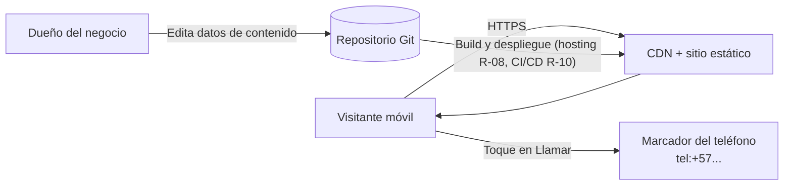
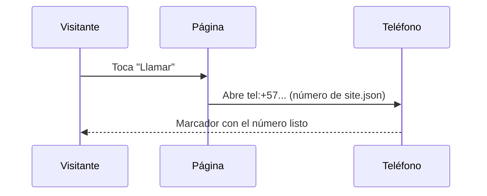

# Plan técnico: Landing Guineo Verde

**Versión:** 2.0 · **Fecha:** 2026-10-24 · **Estado:** Borrador; D7 implementada · **Alcance vigente:** `05-alcance-y-roadmap.md` v1.7

## Índice
1. Contexto arquitectónico
2. Decisiones técnicas (comparativa y recomendación)
3. Arquitectura
4. Estructura del repositorio
5. Modelo de datos de contenido
6. Roadmap técnico (fuera de la Fase 1)
7. Seguridad (controles trazables)
8. Rendimiento y SEO
9. Analítica
10. CI/CD y entornos
11. Riesgos y hallazgos
12. Matriz de trazabilidad

---

## 1. Contexto arquitectónico
**Técnico:** sitio 100 % estático. **Sin backend en la Fase 1**: no hay función de servidor, formularios ni base de datos.
**Funcional:** landing informativa. El contacto es por llamada telefónica, con un enlace `tel:` generado desde un archivo de datos.



## 2. Decisiones técnicas

### D1. Framework

| Criterio | Astro | Next.js (SSG) | Angular SSR | Blazor WASM / SSR |
|---|---|---|---|---|
| JS enviado al cliente | Mínimo (islas) | Medio | Alto | Alto (WASM) o conexión persistente (SSR) |
| LCP en móvil 4G | Muy bueno | Bueno | Medio | Débil (WASM) |
| SEO estático | Excelente | Excelente | Bueno | Medio |
| Curva para tu perfil | Baja | Baja (ya usas React) | Nula (ya usas Angular) | Nula (.NET) |
| Idoneidad para landing | **Alta** | Media-alta | Baja | Baja |

**Decisión: Next.js (exportación estática) + React + TypeScript + Tailwind CSS.** Sin formularios en la Fase 1, el JavaScript en cliente se limita a tres componentes en `src/components/cliente/`: la visibilidad del botón flotante, el mapa de fincas, que carga Leaflet solo al pulsar "Ver mapa" (D6), y el selector de idioma, que solo completa la consulta y el ancla del enlace (D7). El acordeón de FAQ usa `<details>` nativo, sin JavaScript. Alternativa descartada: Astro + React (islas), con menos JavaScript pero una herramienta nueva para el equipo.

### D2. Hosting

| Criterio | Azure Static Web Apps | Cloudflare Pages | Netlify |
|---|---|---|---|
| Familiaridad | **Alta (Azure)** | Media | Media |
| Plan gratuito | Sí, con límites a verificar | Sí, generoso | Sí, con límites |
| CDN | Global | Global, muy extensa | Global |
| Integración con Azure DevOps | Directa | Vía pipeline | Vía pipeline |

**Estado: pendiente de definir antes del primer despliegue (roadmap R-08).** Opción preferida hoy: Azure Static Web Apps, por afinidad con el stack. Alternativa: Cloudflare Pages. La decisión depende de medir latencia desde Colombia y de los límites vigentes del plan gratuito. No se elige hosting en esta versión del spec.

### D3. Analítica (roadmap R-07, fuera de Fase 1)
No se implementa en Fase 1. Cuando se active: **Plausible o Umami** (sin cookies) por defecto, lo que evita el banner de consentimiento. GA4 solo si se necesita integración con Google Ads, y entonces con banner de consentimiento.

### D4. Contacto y backend (diferido)
Fase 1: llamada telefónica (`tel:`). No hay backend. El formulario B2B, el endpoint `/api/b2b`, el anti-spam (Turnstile) y el almacenamiento de leads quedan en el roadmap R-06, y se decidirán cuando se active el formulario.

### D5. Pedido por WhatsApp y pedido en línea (roadmap)
- **R-02 WhatsApp Business:** cuando se active, enlace `wa.me` con mensaje prellenado. No se implementa en Fase 1.
- **R-04 Pedido en línea:** pasarela Wompi o PayU, carrito mínimo y backend de pedidos. No se implementa ahora.

### D6. Mapa de fincas (FR-24, Fase 1)
- **Elegido:** Leaflet (BSD-2, instalado por npm, sin CDN) con teselas de OpenStreetMap. Carga diferida: el módulo se importa dinámicamente al pulsar "Ver mapa". La altura se reserva en CSS para evitar CLS.
- **Descartado:** iframe de Google Maps (peso, cookies y un tercero con más datos) y la API de Google con clave (secreto en el cliente, P6).
- **Plan B (si la revisión jurídica rechaza D-13):** mapa estático en SVG del departamento, sin terceros. Requiere geometría de dominio público y entrada en `doc/creditos.md`.
  - **Ya existe la base del plan B (2026-10-19):** el fondo antes de "Ver mapa" es un mapa ilustrado (`src/lib/mapa-ilustrado.ts`, rutas estáticas `src/app/mapa-fincas.svg/` y `mapa-fincas-movil.svg/`). Su geometría (`src/lib/mapa-base.json`) se derivó de OSM (ODbL, con atribución) y no de una fuente de dominio público. Si se rechaza D-13, bastaría con quitar el botón y Leaflet.
- **Restricciones de implementación:**
  - `MapaFincasInteractivo` es el segundo componente cliente. No importa `@/lib/content`; recibe los datos como props desde el componente de servidor `MapaFincas`.
  - El contenedor del mapa usa `isolate` para que los paneles de Leaflet no tapen la barra superior.
  - Marcadores con `L.divIcon` y clase CSS con tokens; sin imágenes de Leaflet.
  - `Referrer-Policy` compatible con OSM (NFR-04).
  - Las teselas se piden solo para la vista actual (AC-20).

### D7. Español predeterminado e inglés opcional (plan de Fase 12)

**Estado:** implementada el 2026-10-24 (Fase 12, T-87 a T-99), sin dependencias nuevas. El diagnóstico y la investigación que siguen son los del plan; las decisiones tomadas al implementar están en «Implementación» al final de D7.

#### Diagnóstico del checkout local

Punto de partida: rama `main`, commit `5059813`, checkout limpio antes de esta planificación. Stack instalado: Next.js 16.4.2, React 19.3.1 y `output: "export"`; `next-intl` no está instalado.

| Evidencia local | Implicación para el plan |
|---|---|
| `src/app/layout.tsx`: `lang="es-CO"`, metadata y OG españoles; landing y tres legales | No basta traducir textos en cliente. Cada variante necesita HTML inicial y metadatos propios. |
| `src/lib/content.ts`: exports globales monolingües de diez JSON, Zod y validaciones de publicación | Migrar a acceso por idioma explícito sin estado mutable global; validar los dos idiomas en cada build. |
| `src/lib/format.ts`: tres formateadores fijados a `es-CO` | Recibir locale para fecha, número y lista. Mantener UTC para fechas ISO sin hora. |
| `src/lib/seo.ts`, `legal.ts` y `app/sitemap.ts`: rutas y textos españoles | Tabla única de equivalencias, canonical por página, alternates y sitemap bilingüe. |
| Componentes de servidor importan `copy`, `site`, etc.; clientes reciben props | Reutilizar componentes con contenido localizado por props. No convertir la landing en cliente ni enviar ambos catálogos al navegador. |
| `src/lib/mapa-ilustrado.ts` y dos Route Handlers SVG estáticos | Generar también SVG ingleses; etiquetas y alternativas se localizan en build. Geometría y coordenadas se comparten. |
| `src/lib/claims.ts`: frases y marcador `(FICTICIO)` españoles | Ampliar guardas a inglés sin permitir eludir los pendientes de producción. |
| `src/app/fonts/inter-es.woff2`, `src/lib/fuentes.ts` | Comprobar caracteres reales de ambos catálogos antes de regenerar la fuente; no descargar otra familia por idioma. |
| `scripts/budget.mjs` enumera cuatro páginas; e2e enumeran rutas/textos españoles | Ampliar cobertura a ocho páginas, 404, ambas landings y ambos builds. Revisar también Lighthouse, servidor estático y workflow. |
| `eslint.config.mjs`: acceso único al contenido y lista de imports permitidos en clientes; `tests/unit/estructura.test.ts` exige pruebas y trazabilidad | Mantener estas garantías al crear módulos y carpetas de idioma; ajustar patrones para JSON anidados, sin relajar el lint general. |
| `assetPath()` agrega `PAGES_BASE_PATH`; `absoluteUrl()` usa `site.url`, que ya contiene el subdirectorio de la demo | Evitar duplicar `/green-banana-web` y evitar que `/en` contamine las rutas de recursos compartidos. |

#### Buenas prácticas investigadas y decisión contextual

Consulta: 2026-10-24 (America/Bogota). Fuentes primarias; antes de programar, prevalecen las guías incluidas en la versión instalada.

| Fuente | Práctica comprobada | Aplicación al proyecto |
|---|---|---|
| [Next.js: internacionalización](https://nextjs.org/docs/app/guides/internationalization) y `node_modules/next/dist/docs/01-app/02-guides/internationalization.md` | Diccionarios por idioma y render de contenido en Server Components; rutas dinámicas estáticas requieren parámetros generados | Cargar contenido durante el build y pasar solo los textos necesarios al mapa cliente. |
| [Next.js: exportación estática](https://nextjs.org/docs/app/guides/static-exports) y guía local `static-exports.md` | Sin Proxy, cookies de servidor, rewrites ni lógica dependiente de Request; parámetros dinámicos deben predefinirse | Conservar `output: "export"`; no copiar la negociación por `Accept-Language` del ejemplo general. |
| [next-intl: static export](https://next-intl.dev/docs/routing/middleware#usage-without-proxy--middleware-static-export) | Su routing estático exige prefijos de locale; `pathnames` depende de rewrites | No aplicar `localePrefix: "as-needed"` como si funcionara sin servidor. No se recomienda añadir esta dependencia para dos idiomas y cuatro páginas. |
| [Google: sitios multilingües](https://developers.google.com/search/docs/specialty/international/managing-multi-regional-sites) | URL distinta por idioma y acceso explícito a variantes | Mantener español sin prefijo y añadir inglés bajo `/en`; no forzar cambios por configuración del navegador. |
| [Google: versiones localizadas](https://developers.google.com/search/docs/specialty/international/localized-versions) | Alternates completos y recíprocos con códigos válidos | `es-CO`, `en` y `x-default` a español para cada pareja; canonical autorreferente. |
| [W3C: idioma de la página](https://www.w3.org/WAI/WCAG22/Understanding/language-of-page.html) | El idioma principal debe poder determinarse programáticamente | `html lang` correcto desde HTML inicial; textos en otro idioma marcados cuando corresponda. |

**Recomendación:** diccionarios propios tipados, Zod e `Intl`, con rutas estáticas explícitas. Reutiliza el sistema editorial que ya existe y evita un runtime adicional de traducción. **Alternativa:** `next-intl` si más idiomas, plurales complejos o flujo editorial justifican la dependencia; exige replanificar su routing estático (normalmente ambos idiomas prefijados) y verificar presupuesto. No es parte de esta fase instalarla.

#### Contrato de idioma y rutas

| Página lógica | Español (`es-CO`, predeterminado) | Inglés (`en`) |
|---|---|---|
| Inicio | `/` | `/en` |
| Términos | `/terminos` | `/en/terms` |
| Privacidad | `/privacidad` | `/en/privacy` |
| Garantía | `/garantia` | `/en/guarantee` |

- La URL es la fuente de idioma. `/` siempre español; `/en` siempre inglés. Sin detección por IP, navegador, cookies ni localStorage. Recargar o compartir una URL preserva su idioma; volver explícitamente a `/` muestra español.
- Rutas inglesas explícitas: no aceptar arbitrariamente `/fr` ni crear `/es` como otra copia indexable. Resolver con 404 las rutas no publicadas. No hay redirecciones de servidor nuevas.
- Tabla tipada de página lógica → ruta por idioma en un módulo puro (propuesto `src/lib/i18n.ts`), utilizable sin cargar contenido. Links Next reciben rutas sin `basePath` y `prefetch={false}`; recursos compartidos siguen usando `assetPath()`. URL absolutas se componen con `site.url` una sola vez.
- Selector como enlaces nativos a equivalentes, renderizado en servidor, con «Español / English» y estado activo. Para conservar query/hash, una mejora cliente mínima puede completar el destino al interactuar usando URL y la tabla pura: nunca traduce el HTML después de cargarlo, nunca importa catálogos. Sin JS mantiene al menos la página equivalente. No agregar un proveedor cliente global.
- Conservar IDs de anclas entre idiomas. Verificar query y hash en ambos sentidos, incluidos enlaces abiertos en nueva pestaña. El selector no añade prefetch ni activa el mapa.
- Respetar `trailingSlash` existente: sin prefijo en local; con `/green-banana-web/` en demo. Ejemplo inglés publicado: `/green-banana-web/en/privacy/`.

#### Composición y comprobación de compatibilidad (T-88)

Diseño propuesto: grupos de rutas `(es)` y `(en)`, cada uno con layout raíz que emite `<html>` con idioma constante; las páginas inglesas viven bajo `(en)/en/`. Compartir shell, secciones y componentes, sin copiar la landing ni duplicar lógica. Mover el shell actual a una pieza de servidor compartida. Con múltiples layouts raíz, cambiar de idioma puede hacer una carga completa: es aceptable; no exigir navegación SPA. No mantener un layout raíz español envolviendo el inglés ni corregir `document.documentElement.lang` tras hidratación.

**Puerta técnica previa a la migración:** leer las guías locales de route groups, layouts y `not-found.md`; demostrar con Next 16.4.2 el HTML español/inglés, layouts raíz, rutas especiales y exportación de `404.html` en ambos builds. `global-not-found` está documentado como **experimental** y contempla múltiples layouts raíz: si se usa, registrar `experimental.globalNotFound`, justificación y evidencia de exportación en D7/bitácora. No dar por probada su compatibilidad solo por existir en la documentación. Si la prueba no exporta correctamente, detener tareas dependientes y documentar el ajuste arquitectónico necesario sin migrar parcialmente ni quitar `output: "export"`.

404: una página global estática con español principal y ayuda inglesa marcada `lang="en"`, enlaces a ambos inicios, sin canonical/alternates de una página válida y siempre noindex. El hosting estático no elige una 404 por idioma para una URL desconocida; no prometerlo ni cambiar solo el servidor de pruebas para aparentar soporte. Los archivos globales `robots`, `sitemap`, íconos y `security.txt` conservan su dirección; evitar colisiones al mover layouts.

#### Contenido y controles

- Mantener `site.json` como fuente única de identidad/contacto, URL y datos comunes. Separar también IDs, cifras, fechas ISO, coordenadas y flags de confirmación de las descripciones traducibles. El horario visible, notas de origen y otros campos hoy mezclados con datos requieren inventario y separación, no una copia indiscriminada de todos los JSON.
- Propuesta: conservar JSON de datos comunes en `src/content/` y catálogos localizados en `src/content/es-CO/` y `src/content/en/`, con archivos por dominio (copy, products, faq, recipes, origin, zones, legal, testimonials y textos de fincas según inventario). No mantener dos copias editables del español tras migrar.
- `src/lib/content.ts` sigue siendo el único acceso a JSON dentro de `src/`. Exponer `getContent(locale)` con tipo cerrado `"es-CO" | "en"`; sin variable global `currentLocale` ni cambios de idioma por mutación. Validar ambos catálogos incluso si solo se solicita una página española.
- Zod estricto y validación cruzada: igualdad de claves, IDs, número de elementos y conjuntos de variables `{...}` por cadena equivalente; detectar referencias faltantes o duplicadas, claves sobrantes y diferencias de marcadores de pendiente. Componer datos comunes con texto localizado antes del render.
- Mantener helpers puros sin React en `lib/`. Componentes reciben idioma/contenido explícitos; clientes solo props mínimos. Ampliar los patrones de ESLint para carpetas anidadas y permitir únicamente el módulo puro de rutas en el selector, si se necesita.
- Revisar `findForbiddenClaims` para equivalentes ingleses y variantes; revisar `findPendingMarkers` sobre datos comunes y ambos catálogos. Conservar los marcadores actuales o agregar equivalentes detectables probados; no traducirlos de forma que deje pasar producción. Nunca debilitar guards para poder medir inglés.
- Mantener legales como borradores y RP-01 a RP-05 abiertos. Traducir no autoriza publicar producción. No inventar testimonios ni completar datos de negocio pendientes.
- `formatDate`, `formatList` y `formatWeight` reciben idioma explícito. No convertir métricas a libras ni teléfonos a otro país. Mantener placeholders culturales y nombres propios según `02` §1.
- Mapa: mismos datos y estado de salud; props localizadas para todos los estados y controles Leaflet (incluido zoom). Exportar SVG ingleses desktop/móvil bajo `/en/mapa-fincas.svg` y `/en/mapa-fincas-movil.svg` con etiquetas traducidas. Mantener atribución, lazy loading, consentimiento, errores y límites actuales; no traducir geometría ni nombres geográficos.

#### SEO, rendimiento y validación

- Generar metadata por página/idioma: título, descripción, canonical, alternates, OG (incluido locale válido como `en_US` para inglés), Twitter y alternativa de imagen. JSON-LD conserva la misma identidad de negocio y localiza textos/FAQ; `inLanguage` donde el tipo lo admita. Ningún enlace inglés canonicaliza a español.
- `hreflang` recíproco también incluye la propia variante y `x-default` española. T-64 retiró una anotación monolingüe innecesaria; con variantes reales se incorpora de nuevo justificadamente. Sitemap: ocho páginas y alternates consistentes; imágenes y SVG no son páginas de contenido. `robots`/noindex de demo siguen activos para ambos idiomas.
- Auditar texto incrustado en `og.jpg`: si lo contiene, generar variante inglesa y registrar el recurso; si es solo foto, compartirla y traducir `alt`.
- Presupuesto por cada HTML: 300 KB gzip y límite independiente del hero 120 KB. `budget.mjs` debe medir las ocho rutas y ambos heroes, no solo la entrada española. Lighthouse mide `/` y `/en` con el mismo método y límites; CI conserva su carácter informativo.
- `csp.mjs` ya recorre HTML recursivamente: comprobar nuevos HTML y 404, no asumir que necesita cambiar. Validar también SVG localizados con MIME correcto, carga de fuentes, assets sin duplicar prefijo, y ninguna violación CSP.
- Unitarias de módulos nuevos según estructura; e2e importan fixtures existentes, fallan con `pageerror` y no llaman realmente a OSM. Parametrizar pruebas existentes por idioma sin perder las aserciones españolas. Cubrir los tres legales ingleses, navegación de regreso y descarga inicial sin prefetch ni Leaflet.
- Cierre: `npm run validate` y `npm run lighthouse` con cobertura bilingüe, revisión visual/teclado en móvil y escritorio y evidencia real registrada. No marcar tareas hechas por haber redactado el plan. Actualizar bitácora, estado y documentación; no hacer commit/push ni publicar por esta planificación.

#### Implementación (2026-10-24)

**T-88, puerta técnica (superada).** En una copia aislada del checkout, con Next 16.4.2: grupos `(es)` y `(en)` con un layout raíz cada uno, sin `app/layout.tsx`. Ambos builds (sin prefijo y con `/green-banana-web`) exportan las ocho páginas con su `lang`, `404.html`, íconos, `robots.txt`, `sitemap.xml`, `security.txt` y los SVG sin colisiones; `server.mjs` devuelve 200 en las rutas publicadas y 404 en `/no-existe`, `/en/no-existe`, `/es` y `/fr`. **Sin `global-not-found`, Next exporta su propia 404 en inglés y con `<html>` sin `lang`** (incumple AC-28): se usa `global-not-found.tsx` con `experimental.globalNotFound`, que sí exporta `404.html` con `lang="es-CO"`. Es experimental: revisar al actualizar Next (riesgo residual de D-15).

**Composición.**
- `src/app/(es)/` (`/`, `/terminos`, `/privacidad`, `/garantia`) y `src/app/(en)/en/` (`/en`, `/en/terms`, `/en/privacy`, `/en/guarantee`, y los SVG `/en/mapa-fincas*.svg`). Cada layout usa `src/app/documento.tsx` (`<html lang>`, fuentes, CSS y el shell compartido) con su idioma; la landing compartida es `src/app/landing.tsx` y los SVG salen de `src/app/mapa-svg.ts`. Ninguna página duplica lógica: solo fijan su idioma y sus metadatos.
- `src/lib/i18n.ts` (puro, sin contenido): `LOCALES`, `RUTAS` (tabla tipada página → ruta por idioma), `rutaDe`, `paginaDeRuta`, `rutaEquivalente`, `recursoDe` y `OG_LOCALE`. Enlaces internos con `next/link` y `prefetch={false}`; `assetPath()` sigue solo para archivos de `public/` y los SVG.
- **Selector:** `src/components/cliente/SelectorIdioma.tsx`, tercer componente cliente, en el documento compartido (todas las páginas salvo la 404). Calcula la pareja con `usePathname()` y `rutaEquivalente()`: el enlace ya está en el HTML exportado y sin JavaScript cambia de idioma; en el navegador solo agrega `location.search` y `location.hash` (`useSyncExternalStore`, también tras `hashchange`). Recibe los nombres de los idiomas por props; no importa catálogos. Se eligió frente a un selector de servidor por página porque el layout no conoce la página y así no se duplica el shell. Se integra en `TopBar` como control con globo decorativo y nombres completos: en escritorio comparte fila con marca y llamada; por debajo de 1024 px ocupa una segunda fila alineada a la derecha. Idioma activo con fondo, negrita y subrayado; enlaces de 44 px y sin menú. La cabecera sigue fija en móvil; Origen y Mapa reservan 160 px al navegar por ancla para evitar que tape sus títulos. Revisión UX solicitada el 2026-10-24.
- **404:** `global-not-found.tsx` con el mismo documento en español, sin selector, y una sección `lang="en"` con la ayuda y el enlace a `/en` (`NotFoundPage`). No hereda `robots` de los layouts: Next ya agrega `noindex` y en producción el layout diría `index`.

**Contenido.**
- Datos comunes una sola vez en `src/content/`: `site`, `zones` y `origin` sin cambios; `products` (id, pesos, unidades, `pendingConfirmation`), `recipes` (id, tiempo), `testimonials` (id, nombre, foto, autorización) y `fincas` (sin `nombre`). Textos en `src/content/es-CO/` y `src/content/en/`: `copy`, `faq` (lista con id), `legal` y registros por id para `products`, `recipes`, `testimonials` y los nombres de `fincas` (el del acopio se traduce; los de las fincas son nombres propios ficticios).
- `src/lib/content.ts` valida siempre los dos catálogos y expone `getContent(locale)`, que devuelve el contenido ya compuesto (mismos tipos que antes: `Presentation`, `Recipe`, `Finca`…), creado una vez por idioma; `site` e `isProduction` siguen exportados. Ya no hay exports monolingües (`copy`, `products`…): un componente que olvide el idioma no compila.
- `src/lib/paridad.ts` (puro): `diferenciasDeCatalogo` compara el inglés con el español (claves, tipos, largo de listas, `id` por posición, marcadores `{…}` y cantidad de marcas de pendiente) e `idsSinPareja` cruza textos con datos comunes. Cualquier diferencia rompe el build; no hay respaldo de un idioma a otro.
- Guardas: `FORBIDDEN_CLAIMS` suma equivalentes ingleses; la búsqueda de frases y `findPendingMarkers` recorren datos comunes y los dos catálogos (62 marcas hoy: 43 de antes y 19 inglesas). Se conservan los marcadores: `(FICTICIO)` literal en inglés y corchetes con texto inglés.
- `format.ts` recibe el idioma (`Intl` con `es-CO` o `en`, UTC para fechas ISO, unidades métricas). Componentes de servidor reciben `locale` por props y leen `getContent(locale)`.
- ESLint: `SOLO_CONTENT_TS` cubre JSON anidados (`@/content/**`) y los clientes pueden importar `@/lib/i18n`; se comprobó con archivos temporales que importar un catálogo fuera de `content.ts`, o `@/lib/content` y `@/lib/seo` desde un cliente, falla.

**SEO y controles.** `seo.ts` arma `pageMetadata(página, idioma)` (título, descripción, canonical, `alternates.languages` con `es-CO`, `en` y `x-default` español, OG con `og:locale` y `og:locale:alternate`, Twitter) y `rootMetadata` (metadataBase, referrer, robots de demo). `sitemap.ts`: ocho URL con sus alternates. JSON-LD: misma identidad (`@id` común) en los dos idiomas; `FAQPage` con `inLanguage`. `og.jpg` es solo foto: se comparte y se traduce su `alt`. `budget.mjs` mide las ocho páginas y la 404 (lista derivada de `RUTAS`) y el hero en las dos landings; `lighthouse.mjs` mide `/` y `/en` (`LH_RUTAS`), cada una contra el mismo presupuesto y con su tabla en CI. `csp.mjs` y `server.mjs` no necesitaron cambios.

**Pendiente, fuera de esta fase:** revisión editorial del inglés; revisión jurídica de los legales en los dos idiomas (T-05); idioma en que se atienden las llamadas [POR CONFIRMAR] (la página inglesa no promete atención en inglés); prueba manual con lector de pantalla en los dos idiomas (T-38).

## 3. Arquitectura

```mermaid
flowchart TB
    subgraph Cliente
      P[Páginas Next.js exportadas a HTML estático]
      I1[Acordeón FAQ: details/summary nativo, sin JS]
      I2[Componente cliente: visibilidad del botón flotante Llamar]
      I3[Componente cliente: mapa de fincas; Leaflet con import() al pulsar "Ver mapa"]
      I4[Componente cliente: selector de idioma; completa ?consulta#ancla del enlace]
    end
    subgraph Datos comunes en src/content
      D1[site.json: marca, contacto, legales, acopio]
      D2[products.json: id, pesos, unidades, pendientes; sin precio]
      D3[zones.json: acopio y puntos de distribución]
      D5[recipes.json: id y tiempo]
      D6[origin.json: lote vigente]
      D8[testimonials.json: vacío hasta tener testimonios reales]
      D10[fincas.json: ubicaciones y municipios del mapa]
    end
    subgraph Catálogos por idioma: src/content/es-CO y src/content/en
      C1[copy.json: textos de interfaz por sección]
      C2[faq.json, legal.json]
      C3[products, recipes, testimonials y fincas: textos por id]
    end
    D1 & D2 & D3 & D5 & D6 & D8 & D10 & C1 & C2 & C3 -->|Build: Zod, paridad entre idiomas y guardas en lib/content.ts; getContent locale| P
```

**Flujo del botón de llamada**



## 4. Estructura del repositorio

```
green-banana-web/
├─ src/
│  ├─ app/               # Rutas (App Router): (es)/ y (en)/en/ con un layout raíz por idioma (D7), global-not-found.tsx,
│  │                     # documento.tsx (<html lang> y shell compartido), landing.tsx (landing de los dos idiomas),
│  │                     # robots.ts, sitemap.ts, mapa-fincas.svg/ y mapa-fincas-movil.svg/ (SVG en build; las
│  │                     # inglesas en (en)/en/, generadas con mapa-svg.ts), globals.css (tokens de diseño)
│  │                     # y fonts.ts (next/font, autoalojadas)
│  ├─ components/
│  │  ├─ secciones/      # Una por sección de la página: TopBar, Hero, TrustBar, ProductCards, Origin,
│  │  │                  # MapaFincas, Recipes, ..., FinalCta, Footer
│  │  ├─ ui/             # Piezas reutilizables: CallButton, Picture, LegalPage, NotFoundPage, DemoBanner, FloatingCall, SkipLink
│  │  ├─ cliente/        # Los únicos componentes con "use client": FloatingCallVisibility, MapaFincasInteractivo, SelectorIdioma
│  │  └─ seo/            # Datos estructurados: LocalBusinessJsonLd
│  ├─ content/           # JSON editables: datos comunes (site, products, zones, recipes, origin, testimonials, fincas) y textos en es-CO/ y en/ (copy, products, faq, recipes, legal, testimonials, fincas)
│  └─ lib/               # Lógica pura sin React: content.ts (único acceso al contenido), schema.ts (Zod),
│                        # claims.ts, paridad.ts (paridad entre idiomas), i18n.ts (idiomas y rutas), tel.ts, seo.ts,
│                        # legal.ts, images.ts, asset.ts, template.ts, format.ts, fuentes.ts, salud-mapa.ts,
│                        # mapa-ilustrado.ts + mapa-base.json, csp.ts, security-txt.ts (analytics.ts entra con R-07)
├─ public/               # images/ (generadas por npm run images); robots.txt lo genera src/app/robots.ts
├─ scripts/              # images.mjs, icons.mjs, csp.mjs (después de next build), build-prefijo.mjs, budget.mjs,
│                        # lighthouse.mjs + lighthouse-presupuesto.mjs (lógica pura del presupuesto)
├─ tests/                # unit/ (Vitest; refleja src/: components/secciones/, ui/, seo/ y lib/, más scripts/ para la
│                        # lógica pura de los scripts; estructura.test.ts lo verifica)
│                        # y e2e/ (Playwright + server.mjs)
├─ spec/                 # 00 a 05 (05 = alcance y roadmap)
├─ doc/                  # bitácora y créditos (el resto, solo local)
├─ .github/              # pages.yml (verifica y publica la demo) y dependabot.yml; la pipeline completa llega con R-10
└─ archivos de configuración en la raíz (Next, TypeScript, ESLint, Prettier, Vitest, Playwright)
```

Carpetas generadas, fuera de Git: `node_modules/`, `.next/`, `out/` (build estático), `test-results/` y `fotos-originales/`.

Dependencias entre capas (en un solo sentido): `app/` → `components/` → `lib/` → `content/`. Los componentes cliente no importan `lib/content.ts`; reciben datos por props.

ESLint hace cumplir estas reglas en `npm run lint` (y por tanto en `validate`), con `no-restricted-imports` y `no-restricted-syntax` en `eslint.config.mjs`:
- los JSON de `src/content/` solo se importan en `src/lib/content.ts`. La regla vale dentro de `src/`, no en `scripts/` ni en `tests/` (decisión del usuario, 2026-10-23): `scripts/images.mjs` corre en Node sin el alias `@/`, y las pruebas alteran los JSON para comprobar que los esquemas los rechazan. Lo que llega al navegador queda protegido, y `testimonialImage` valida `photo` antes de que el script arme la ruta;
- `components/` y `lib/` no importan `src/app/`, y `lib/` no importa componentes;
- `components/cliente/` no importa `@/lib/content` ni los demás módulos de `lib/` que lo cargan: solo `schema` (tipos), `template`, `format`, `tel`, `salud-mapa` e `i18n`;
- `"use client"` solo se permite en `components/cliente/`, y `"use server"` en ninguna parte (no hay servidor con `output: "export"`);
- todo `<Link>` declara `prefetch` (en la práctica `prefetch={false}`): con exportación estática, Next descargaba completas las páginas enlazadas al cargar, sin clic (T-61).

`tests/unit/estructura.test.ts` comprueba que cada módulo de `components/` y `lib/` tenga su prueba en la carpeta equivalente de `tests/unit/` (salvo `components/cliente/`, que necesita navegador y se prueba con e2e; lista aprobada por el usuario el 2026-10-23, y agregarle algo requiere justificarlo en el PR), que no haya pruebas sin módulo, y que cada FR de `01-spec.md` aparezca en la matriz de §12. En `tests/unit/scripts/`, la prueba de un script es **opcional** (decisión del usuario, 2026-10-24: hoy solo la tiene `lighthouse-presupuesto.mjs`), pero si existe debe corresponder a un módulo `.mjs` de `scripts/`.

No hay carpeta `api/` en la Fase 1 (ver roadmap R-06).

## 5. Modelo de datos de contenido

Datos comunes en `src/content/*.json`; textos en un catálogo por idioma, `src/content/es-CO/` y `src/content/en/` (D7). `getContent(locale)` entrega los tipos ya compuestos (dato común + texto del idioma).

```ts
// src/content/products.json (esquema Fase 1: sin precios). Datos comunes.
type ProductData = {
  id: 'unit' | 'kg' | 'bag' | 'box';
  approxWeightG?: number | [number, number];  // peso por unidad o total; rango [mín, máx] p. ej. la caja
  approxUnits?: string;          // "4–5"
  pendingConfirmation?: Array<'approxWeightG' | 'approxUnits'>;  // cifras sin confirmar (T-03): se muestran entre corchetes y bloquean producción
};
// src/content/<idioma>/products.json: un texto por id.
type ProductTexts = Record<ProductData['id'], {
  label: string;
  callLabel: string;             // "Llamar para precio" / "Call for price"
  imageAlt: string;              // texto alternativo de la foto
}>;
type Presentation = ProductData & ProductTexts[string];  // lo que reciben los componentes

// src/content/site.json (esquema Fase 1)
type Site = {
  brand: string;                 // [POR CONFIRMAR nombre comercial]
  url: string;                   // URL pública https, sin "/" final (canónica, sitemap, Open Graph); demo hoy, dominio en RP-01
  phone: string;                 // E.164 con "+": "+573000000000" (FICTICIO en desarrollo)
  phoneIsPlaceholder: boolean;   // true mientras el número sea ficticio; bloquea el build con SITE_ENV=production
  schedule: string;              // [POR CONFIRMAR horario]
  legal: { razonSocial: string; nit: string; direccion: string; correo: string };  // ficticios en Fase 1 (Q6); el teléfono del pie es `phone`
  // brand: Q1. phone: Q7. Sin campos de precio en Fase 1.
  sicUrl: string;                // enlace visible a la SIC
  acopio: { city: string; department: string };   // "Santa Marta", "Magdalena"
};

// src/content/zones.json (esquema Fase 1)
type Zone = {
  name: string;                  // punto de venta o municipio de distribución
  type: 'punto_de_venta' | 'municipio';
};

// src/content/fincas.json (FR-24; datos ficticios en Fase 1, esquema estricto). Datos comunes;
// el nombre de cada ubicación va en src/content/<idioma>/fincas.json ({ [id]: nombre }).
type Fincas = {
  centro: { lat: number; lng: number };  // valor inicial si no hay ubicaciones
  zoom: number;                          // 5 a 15
  fincas: Array<{
    id: string;                          // slug
    tipo: 'finca' | 'acopio';
    municipio: string;                   // nombre propio: no se traduce
    lat: number;                         // -90 a 90
    lng: number;                         // -180 a 180
    productor: string;                   // "(FICTICIO)" hasta RP-02
  }>;
};
```

Del mismo modo, `recipes.json` guarda id y tiempo, y `testimonials.json` id, nombre, foto y autorización; sus textos van por id en cada catálogo. `faq.json`, `legal.json` y `copy.json` son enteramente por idioma.

Los esquemas se validan en build (Zod) en `src/lib/schema.ts` y `src/lib/content.ts`, para los datos comunes y los dos catálogos; `src/lib/paridad.ts` exige que el inglés tenga las mismas claves, IDs, marcadores y marcas de pendiente que el español; los objetos son estrictos, así que un campo no previsto (por ejemplo, un precio) también rompe la compilación. Un dato legal faltante o un número con `phoneIsPlaceholder: true` en producción rompe la compilación. "Producción" es el build con `SITE_ENV=production`, que solo usa la pipeline de producción; el build local y el de la demo no lo definen (D-11). `faq`, `recipes` y `origin` siguen el copy de `02-content-spec.md`.

**Textos de interfaz (`copy.json`, principio P9).** Títulos, subtítulos, botones y microcopy de cada sección viven en el `copy.json` de cada idioma (`src/content/es-CO/` y `src/content/en/`, D7), con un bloque por sección que se agrega al construirla. Los componentes no escriben texto propio. Un texto que combina datos usa marcadores, p. ej. `"Acopio en {ciudad}"`, que rellena `src/lib/template.ts` con datos de `site.json`; el esquema exige que cada marcador esté presente. La franja de demo (`demoNotice`, D-11) también vive aquí. Los precios y su esquema (`pricePerKg`, `priceTotal`) se agregan con el roadmap R-01, no antes.

## 6. Roadmap técnico (fuera de la Fase 1)

| ID | Componente | Dependencia |
|---|---|---|
| R-01 | Precios en `products.json` (`pricePerKg`, `priceTotal`), `Product` con `Offer` en JSON-LD, revisión contra referencia de Santa Marta (D-05 del alcance) | Decisión de precios y validación jurídica (D-01) |
| R-02 | `whatsapp.ts` (URL `wa.me`, plantillas, codificación) y botón de WhatsApp | Cuenta WhatsApp Business |
| R-03 | Ampliar `zones.json` con municipios fuera de Santa Marta y ajustar `Coverage` | Capacidad de reparto validada |
| R-04 | Carrito mínimo, pasarela (Wompi o PayU) y backend de pedidos (ver D5) | Operación de pedidos estable |
| R-05 | Nuevos productos (harina y chips) en `products.json` | Registro INVIMA |
| R-06 | `B2BForm`, función `/api/b2b`, Turnstile, honeypot, límite de frecuencia, correo y tabla de leads | Consentimiento Ley 1581 y decisión de canal |
| R-07 | Analítica: `analytics.ts`, eventos FR-20, UTM, herramienta Plausible o Umami | Decisión de herramienta |
| R-08 | Validación de latencia desde Colombia y de límites del plan gratuito de hosting; plan B Cloudflare Pages | Medición en preproducción |
| R-09 | Facturación electrónica: proveedor y datos para la factura | Decisión de proveedor (Q8) |
| R-10 | Pipeline en GitHub Actions (mismo proveedor que el repositorio), con los pasos de §10; la pipeline reutiliza el script de validación de T-11 | Decisión de proveedor antes de desplegar en distintos entornos |

### 6.1 Contrato `POST /api/b2b` (referencia para R-06, no implementar en Fase 1)

`POST /api/b2b` · `Content-Type: application/json`

```json
{
  "name": "string 2-80",
  "business": "string 2-100",
  "phone": "string formato CO",
  "city": "string 2-80",
  "weeklyKg": 120,
  "consent": true,
  "turnstileToken": "string",
  "honeypot": ""
}
```

| Código | Cuándo |
|---|---|
| 200 | Recibido |
| 400 | Validación fallida (mensaje genérico, sin detalle interno) |
| 403 | Turnstile inválido |
| 429 | Exceso de solicitudes |
| 500 | Error interno (sin trazas hacia el cliente) |

## 7. Seguridad (controles trazables, ISO 27001 y OWASP)

| Riesgo | Control | Requisito |
|---|---|---|
| Inyección o XSS (A03) | Sin HTML dinámico no confiable, escape por defecto, JSON-LD serializado con `jsonLd()` de `src/lib/seo.ts` (escapa `<`), CSP estricta | NFR-04 |
| Configuración insegura (A05) | Cabeceras HSTS, `X-Content-Type-Options`, `Referrer-Policy`, `Permissions-Policy` en el archivo de configuración del hosting elegido en R-08 (p. ej. `staticwebapp.config.json` en Azure Static Web Apps o `_headers` en Cloudflare Pages). Con exportación estática, `next.config` no aplica cabeceras | NFR-04 |
| Componentes vulnerables (A06) | `npm audit` completo (producción y desarrollo) en el script de validación local (`npm run validate`, `audit:deps`) y, desde T-72, también en el job `verificar` de GitHub Actions, como primer paso bloqueante: falla con vulnerabilidades altas o críticas y frena la publicación (excepciones según D-14 de `05`); ESLint sin `eslint-config-next` para evitar `braces` (T-49); Dependabot (actualizaciones semanales, alertas y PR de seguridad) desde T-40; versiones fijadas con `package-lock.json`; acciones de GitHub fijadas por SHA de commit, actualizadas por Dependabot; `checkout` con `persist-credentials: false`, para que el token no quede al alcance de los scripts de las dependencias | NFR-04 |
| Fuga de secretos | Ninguno en Fase 1 (sitio sin backend). Cuando se active R-06, claves solo en variables del servidor | P6 |
| Privacidad (Ley 1581) | Sin formularios ni datos personales en Fase 1; analítica sin cookies | NFR-09 |
| Disponibilidad | Sitio estático en CDN | NFR-06 |
| Suplantación o falsificación de marca | Dominio propio con HTTPS | P6 |

**CSP (T-66, 2026-10-24).** Next.js deja scripts en línea en cada página, así que se usan **hashes** y no `'unsafe-inline'`. `scripts/csp.mjs` corre dentro de `npm run build`, después de `next build`: calcula el hash de cada script en línea ejecutable de cada HTML de `out/` y agrega la política por `<meta>` (`src/lib/csp.ts`). La política, igual en todas las páginas salvo los hashes:
```
default-src 'self'; script-src 'self' 'sha256-…'; style-src 'self' 'unsafe-inline'; img-src 'self' data: https://tile.openstreetmap.org; font-src 'self'; connect-src 'self'; object-src 'none'; base-uri 'none'; form-action 'none'
```
- `style-src 'unsafe-inline'`: la página 404 de Next trae `<style>` y atributos `style`, y Leaflet posiciona el mapa con estilos en línea.
- Por `<meta>` no aplican `frame-ancestors` (anti-clickjacking) ni las demás cabeceras. Llegan con el hosting de producción (T-32, R-08): `frame-ancestors 'none'`, HSTS, `X-Content-Type-Options` y `Permissions-Policy`.
- **Decisión pendiente para T-32 [POR CONFIRMAR]:** los hashes cambian por página y por build, así que no pueden vivir fijos en la configuración del hosting. Si conviven la `<meta>` y una cabecera CSP, el navegador aplica las dos y gana la más restrictiva. Opciones: (a) que `scripts/csp.mjs` genere también la cabecera por página (`_headers` en Cloudflare Pages o `staticwebapp.config.json` en Azure); (b) dejar `script-src` solo en la `<meta>` y poner en la cabecera únicamente `frame-ancestors` y las demás.
- `Referrer-Policy` ya se declara por `<meta>` (`metadata.referrer`, T-62).
- `tests/e2e/csp.spec.ts` falla con cualquier violación en las 4 páginas, la 404, el mapa cargado y la navegación entre páginas.

## 8. Rendimiento y SEO

| Técnica | Detalle |
|---|---|
| HTML estático | Todo el contenido renderizado en build |
| Imágenes | AVIF/WebP (JPG de respaldo en el hero), `srcset` con versiones menores (tarjetas 200 px, recetas 400 px, origen 600 px), `width` y `height` explícitos, `loading="lazy"` fuera del primer viewport, imagen del hero con `fetchpriority="high"`. Configuración en `src/lib/images.ts`; las genera `npm run images` |
| Fuentes | Autoalojadas, subconjunto latino, máximo 2 familias, `font-display: swap` |
| JavaScript | Tres componentes cliente (`'use client'`): la visibilidad del botón flotante, el mapa de fincas (D6; Leaflet se carga con `import()` solo al pulsar "Ver mapa", fuera de la carga inicial) y el selector de idioma (D7; ~1 KB); el acordeón de FAQ usa `<details>`/`<summary>` nativos (accesible y sin JavaScript); el resto se renderiza en build |
| CSS | Tailwind con purga, en un archivo enlazado. El CSS en línea (`experimental.inlineCss`) se probó y se descartó: duplica el CSS en el HTML |
| Terceros | Ninguno en Fase 1. La analítica (R-07) tendrá como máximo un script diferido |
| SEO | Metadatos, Open Graph, JSON-LD (LocalBusiness, FAQPage), `sitemap.xml`, `robots.txt`. La URL base es `url` en `site.json`. Fuera de producción (demo con datos ficticios, D-11) la página lleva `noindex` y `robots.txt` bloquea el rastreo; con `SITE_ENV=production` se permite y se publica el sitemap. **En la demo, la señal efectiva es el `noindex`:** GitHub Pages sirve el sitio en un subdirectorio y los buscadores solo leen `robots.txt` en la raíz del host (`masterarqsoft.github.io/robots.txt`, que da 404), así que el que genera el proyecto no se aplica ahí (SEO-OBS, T-84). Con dominio propio sí se lee. No combinar en un mismo sitio `Disallow` con `noindex`: si el rastreo está bloqueado, el buscador no llega a leer el `noindex` |
| Presupuesto | Peso inicial ≤ 300 KB transferido con gzip (HTML + JS + CSS + fuentes precargadas; sin los polyfills `<script noModule>`, que los navegadores actuales no descargan, T-83), medido por `npm run budget` en cada `validate`; imagen del hero ≤ 120 KB por archivo, que `budget` también verifica (P5). `budget` informa además el total con la foto del hero de cada viewport (2026-10-24, tras la Fase 12: `/` 205,8 KB y `/en` 206,0 KB; con el hero, 237,3 KB en móvil y 262,8 KB en escritorio; las legales, ~190 KB, y la 404, 147,1 KB. Mide las ocho páginas y la 404. El AVIF del hero usa calidad 50, `avifQuality` en `images.ts`, e Inter va recortada a 23,9 KB), para no leer los 300 KB como la carga completa (T-73) |

## 9. Analítica (roadmap R-07, fuera de Fase 1)

Esta sección se conserva como referencia para R-07. En Fase 1 no se carga ningún script de analítica.

| Evento | Parámetros | Disparador |
|---|---|---|
| `click_call` | `source` (hero, card, floating, footer, final) | Toque en cualquier enlace `tel:` |
| `view_presentations` | – | La sección entra al 50 % del viewport |
| `view_origin` | – | La sección de origen entra al 50 % del viewport |
| `open_faq` | `question_id` | Apertura de un ítem |
| `scroll_75` | – | 75 % de profundidad |

Ningún evento lleva datos personales. Los parámetros UTM se leen para medir el origen de la visita y no se envían en eventos de contacto.

## 10. CI/CD y entornos

**Estado:** proveedor decidido: **GitHub Actions**, porque el repositorio está en GitHub (decisión D-10 de `05`). La pipeline y los entornos se configuran en R-10.

**Regla obligatoria:** el repositorio y la pipeline deben estar en el mismo proveedor.

Mientras R-10 esté pendiente, la validación completa se ejecuta en local (`npm run validate`). La demo de GitHub Pages (`.github/workflows/pages.yml`, D-09) se publica en cada push a `main` solo si pasa el job `verificar`: formato, lint, tipos, pruebas unitarias, build, presupuesto de peso y pruebas e2e. Desde T-71, `verificar` también construye la demo con su prefijo (`npm run build:prefijo`, en `out-pages/`), le corre una prueba de humo (`tests/e2e/prefijo.spec.ts`: 5 rutas sin recursos rotos ni violaciones de CSP, imágenes, Leaflet, navegación, íconos y `security.txt`) y sube **ese mismo artefacto** a Pages: lo publicado es lo verificado. Con prefijo, `trailingSlash` está activo, porque sin él Next pedía el payload de la página de inicio fuera del sitio. Desde T-72 incluye `npm audit` como primer paso bloqueante (excepciones según D-14). Desde T-85, el job `lighthouse` (aparte, `needs: verificar`, `continue-on-error`, solo lectura) corre `npm run lighthouse` como **informativo** (CI-01): deja una tabla en el resumen del job y el JSON como artefacto, pero no bloquea ni retrasa `deploy`, que no depende de él, porque los servidores de GitHub varían entre corridas. El bloqueo por rendimiento sigue siendo local; R-10 decidirá si pasa a bloquear con un entorno estable. Lighthouse se descarga con `npx` en versión exacta (13.5.0), fuera del lockfile y de `npm audit`, igual que en local. En los pull requests a `main` (entre ellos los de Dependabot) corre solo `verificar`, sin publicar.

| Entorno | Rama | Propósito |
|---|---|---|
| Local | – | Desarrollo (número ficticio) |
| Preview | Pull request | Revisión visual y pruebas e2e por cambio |
| Producción | `main` | Publicación tras aprobación; falla si `phoneIsPlaceholder` es `true` |

**Pasos del pipeline (independientes del proveedor):** instalar → validar esquemas de contenido → lint y tipos → pruebas unitarias → build → pruebas e2e (Playwright) → Lighthouse CI con umbrales → `npm audit` → despliegue. Se configura cuando se defina R-10.
**Umbrales de bloqueo:** Lighthouse móvil (mediana de 3 corridas) < 90 en cualquiera de las cuatro categorías o fuera del presupuesto de laboratorio de métricas (`scripts/lighthouse-presupuesto.mjs`: LCP ≤ 3,4 s, CLS ≤ 0,1, TBT ≤ 200 ms; T-75 y T-76), o vulnerabilidades altas o críticas.

## 11. Riesgos y hallazgos

| # | Riesgo | Probabilidad | Impacto | Mitigación |
|---|---|---|---|---|
| R1 | Prometer entrega que la operación no puede cumplir (perecedero, sin paquetería) | Alta | Alto | Q5 resuelto: reparto propio, solo en Santa Marta. No publicar horarios ni costos de entrega en Fase 1; se informan por teléfono. Ampliar cobertura solo con R-03 |
| R2 | Precio informado por teléfono sin cumplir Ley 1480 | Media | Alto | Validación jurídica antes de producción (RP-03, D-01) |
| R3 | Afirmaciones de salud o ahorro sin respaldo | Media | Alto | Revisión de copy contra P1 y P3; lista legal |
| R4 | Sin testimonios reales al lanzar | Alta | Bajo | La sección no se publica hasta tener testimonios (AC-11) |
| R5 | Número de contacto ficticio publicado por error | Media | Alto | `phoneIsPlaceholder` bloquea el build de producción |
| R6 | Normativa citada en el informe sin validar | Media | Alto | Revisión de asesor jurídico antes del lanzamiento |
| R7 | Latencia desde Colombia en el hosting elegido | Baja-Media | Medio | Medir en preproducción; plan B Cloudflare Pages |
| R8 | Dependencia de una sola línea telefónica como canal | Media | Medio | Roadmap R-02 (WhatsApp) y R-06 (formulario) |

## 12. Matriz de trazabilidad

| Requisito | Componente / decisión | Tarea | Prueba |
|---|---|---|---|
| FR-01 | `TopBar`, `site.json` | T-12 | AC-01 (e2e) |
| FR-02 | `Hero`, `CallButton` | T-13 | AC-01, AC-02, AC-03 |
| FR-03 | `TrustBar` | T-14 | Visual |
| FR-04 | `ProductCards` sin precio, `products.json` | T-15 | AC-02 |
| FR-05 | `FreshInfo` | T-16 | Visual |
| FR-06 | `Origin`, `origin.json` | T-17 | Visual |
| FR-07 | `Recipes`, `recipes.json` | T-18 | Visual |
| FR-08 | `Benefits` | T-46 | Revisión de copy (AC-07, P3) |
| FR-09 | `HowItWorks` | T-19 | Visual |
| FR-10 | `Coverage`, `zones.json` | T-20 | Revisión de contenido (AC-04) |
| FR-11 | `Business` con `CallButton` | T-21 | AC-03 |
| FR-12 | `Testimonials` (condicional) | T-23 | AC-11 |
| FR-13 | `Faq`, JSON-LD | T-24 | AC-09 |
| FR-14 | `Guarantee` | T-25 | Visual |
| FR-15 | `FinalCta` con `CallButton` | T-47 | AC-03 |
| FR-16, FR-18 | `Footer`, páginas legales | T-26, T-27 | AC-05, AC-06 |
| FR-17 | `FloatingCall` | T-28 | Visual móvil |
| FR-19 | Marca de `TopBar` y "Volver al inicio" en `LegalPage` | T-51 | AC-14 |
| FR-20, FR-21, FR-22, FR-23 | Roadmap R-07 (analítica) | – | AC-10 (ausencia de scripts) |
| FR-24 | `MapaFincas`, `MapaFincasInteractivo`, `fincas.json` (D6) | T-52 a T-56 | AC-15 a AC-20 |
| FR-25 | Idioma de URL y layouts raíz `(es)`/`(en)` (D7) | T-88, T-92 | AC-21, AC-22 |
| FR-26 | `lib/i18n.ts` y `SelectorIdioma` (D7) | T-88, T-93 | AC-23 |
| FR-27 | `getContent(locale)`, `lib/paridad.ts`, guardas, formatos, mapa y fuentes (D7) | T-89 a T-92, T-95 | AC-24, AC-26, AC-27 |
| FR-28 | `pageMetadata`, sitemap, `global-not-found`, budget y Lighthouse bilingües (D7) | T-88, T-94, T-96 a T-99 | AC-22, AC-25, AC-28, AC-29 |
| NFR-01 a 03 | Optimización, SEO | T-30, T-31 | AC-08 |
| NFR-04 | Cabeceras, CSP | T-32 | Escaneo de cabeceras |
| NFR-09 | Sin formularios; sin analítica en Fase 1 | T-27 | AC-12 |
