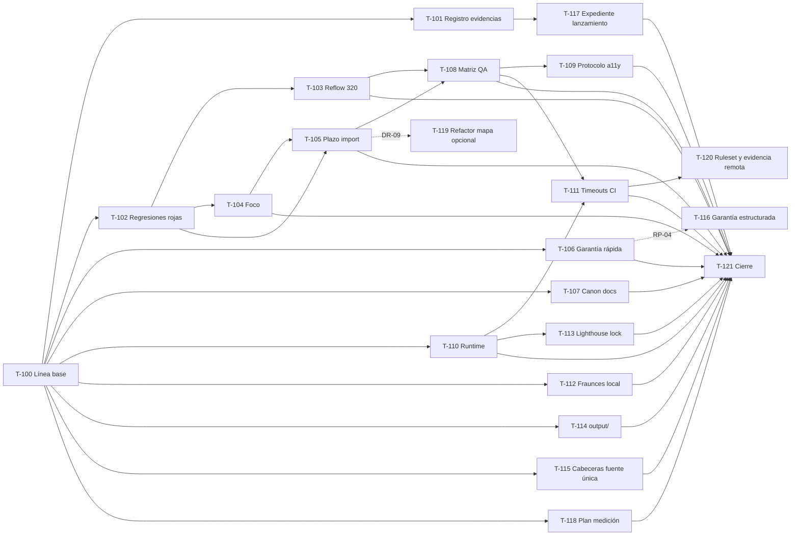

# Plan de remediación: auditoría forense del 2026-10-24

| Campo | Valor |
|---|---|
| Estado | **Ejecutado el 2026-10-25 (Olas 0 a 5 y cierre T-121); integrado en `main` con `b128a67` (PR #7) y desplegado en la demo el mismo día.** Estado de cada hallazgo en `doc/registro-hallazgos.md`. Decisiones del usuario del 2026-10-25: titulares de garantía aprobados (F-05) y DR-04 sustituida (F-08 aceptado sin almacenamiento adicional). T-116 bloqueada hasta RP-04; T-119 diferida (DR-09). INC-01 resuelta con DR-13 (T-122). **Cierre del 2026-10-25 (segunda parte):** DR-05 confirmada (smoke de WebKit y Firefox bloqueantes en `verificar`), plan de medición aprobado (F-13: solo documento y procedimiento manual), 404 con `frame-ancestors` por cabecera y proveedor explícito (N-6 b y c), cargador portable (N-6 a), `sizes` de las tarjetas verificado (N-5) y ruleset de `main` configurado por Claude Code con autorización del usuario (B11) |
| Origen | `doc/auditorias/2026-10-24/informe-forense.md` (local, fuera de Git). SHA-256 del informe: `6a8c78ff48dbd018c00afb53d23a7b43abe22b49b031269116504636abe02cac`. Paquete `auditoria-forense-2026-10-24.zip`: `f645e8c5a8393986269891d327f53734a72d01f60f1fe69c4e520c47deb09f32` |
| HEAD auditado | `10cd67bbbc63fed2189fb5a4a0e2d829beb67aa8` (`main`) |
| Alcance | 17 hallazgos (F-01 a F-17): 1 alto de lanzamiento, 12 medios, 4 bajos. Sin crítico ni alto explotable demostrado |
| Jerarquía | Este plan **no es fuente de verdad**. Si contradice `spec/05-alcance-y-roadmap.md`, la constitución o `CLAUDE.md`, ganan ellos. Al aprobarse, sus tareas se integran como **Fase 13** en `spec/04-tasks.md` conservando los IDs T-100 a T-121 |
| Ejecutor | Claude Code, sobre el checkout local, siguiendo `CLAUDE.md` (pedir confirmación antes de modificar, bitácora y estado por tarea, sin commit ni push salvo orden expresa) |

## Índice

1. [Resumen ejecutivo](#1-resumen-ejecutivo)
2. [Principios de la remediación](#2-principios-de-la-remediación)
3. [Trazabilidad hallazgo → tarea → control](#3-trazabilidad-hallazgo--tarea--control)
4. [Registro de decisiones conjuntas](#4-registro-de-decisiones-conjuntas)
5. [Olas de ejecución y dependencias](#5-olas-de-ejecución-y-dependencias)
6. [Tareas para Claude Code (T-100 a T-121)](#6-tareas-para-claude-code-t-100-a-t-121)
7. [Tareas que no puede cerrar Claude Code](#7-tareas-que-no-puede-cerrar-claude-code)
8. [Riesgos del propio plan](#8-riesgos-del-propio-plan)
9. [Instrucciones de ejecución para Claude Code](#9-instrucciones-de-ejecución-para-claude-code)
10. [Fuentes de buenas prácticas consultadas](#10-fuentes-de-buenas-prácticas-consultadas)

---

## 1. Resumen ejecutivo

**Funcional (negocio):** la demo sigue siendo válida como POC. El lanzamiento comercial sigue bloqueado por datos reales y aprobaciones (RP-01 a RP-05, F-01), que **no se resuelven con código**. Lo que sí se corrige ya: un desborde a 320 px en español, dos fallos del mapa opcional (carga sin salida y foco que salta) y una promesa de garantía que contradice la política pendiente.

**Técnico:** no hace falta migrar framework, añadir backend ni refactorizar la web. La remediación es quirúrgica y se ordena así:

| Ola | Qué | Hallazgos | Esfuerzo Claude Code |
|---|---|---|---|
| 0 | Línea base fresca y registro de evidencias | ND de E05/E12/E13, F-08 | 5 h |
| 1 | Defectos reproducidos, con prueba primero | F-02, F-03, F-04, F-05 (rápido), INC-01 | 20 h |
| 2 | Canon documental | F-06, F-07 | 1,5 h |
| 3 | Aseguramiento QA y accesibilidad | F-10, F-09 (preparación) | 11 h |
| 4 | Reproducibilidad y DevEx | F-12, F-14, F-15, F-16, `output/` | 11,5 h |
| 5 | Preparación de producción (con bloqueos externos) | F-11, F-01, F-05 (sostenible), F-13, rulesets | 20 h |
| 6 | Refactor opcional del adaptador de mapa | F-17 | 8–16 h (diferible) |
| Cierre | Validación completa, revisión independiente, documentación | Todos | 3 h |
| **Total** | | | **~72 h** sin F-17 (incluye T-122, 1 h); ~80–88 h con F-17. Excluye esperas de terceros y la sesión humana con lector de pantalla |

**Gate de salida de la fase:** los 3 defectos reproducidos dejan de reproducirse con las mismas sondas del informe (E07–E09), en ES y EN; la garantía es coherente en los 6 textos; `validate` sale con código 0 fuera del sandbox; advisories y Lighthouse frescos registrados. **No equivale a aprobación de producción.**

---

## 2. Principios de la remediación

1. **Prueba roja primero.** Cada defecto reproducido (F-02, F-03, F-04) se convierte en una regresión e2e que falla en el HEAD auditado y pasa tras la corrección. Mismo patrón que T-78/T-79.
2. **Corregir la causa inmediata probada, no la hipótesis sistémica.** Las causas sistémicas del informe son hipótesis de confianza Media; se atacan con controles (matriz de pruebas, registro de evidencias), no con reescrituras.
3. **Cierre = escenario probado, no suite verde** (recomendación estratégica 3 del informe). Una tarea cierra con la evidencia indicada en su columna "Cierre"; la sola existencia de pruebas no cierra nada.
4. **Sin atajos sobre los gates.** No se borran marcadores `(FICTICIO)`/`[POR CONFIRMAR]` para pasar la guarda de producción; no se oculta overflow con `overflow-hidden`; no se debilitan presupuestos ni el audit.
5. **Proporcionalidad.** Nada de microservicios, DB, analítica activa, formularios ni dependencias de runtime nuevas. Toda dependencia de desarrollo nueva pasa por decisión explícita (§4).
6. **Datos separados del código** (principio 7 del proyecto). La garantía y las cabeceras pasan a tener **una sola fuente** de la que se derivan los textos y archivos.
7. **Trazabilidad auditable.** Cada cierre registra: ID namespaced del hallazgo, commit/archivo, prueba que lo demuestra, evidencia y residual (alineado con ISO/IEC 27001:2022 A.5.28, recopilación de evidencias).

---

## 3. Trazabilidad hallazgo → tarea → control

| Hallazgo | Prioridad | Tipo | Tarea(s) | Control que queda | Decisión |
|---|---|---|---|---|---|
| F-01 Identidad/datos no aptos para producción | P0 | Negocio | T-117 (+ usuario) | Expediente de lanzamiento + guarda existente | — |
| F-02 Reflow 320 px en tarjetas ES | P1 | A11y/UX | T-102, T-103 | Proyecto Playwright `movil-320` + prueba de reflow y espaciado de texto | **DR-01** |
| F-03 Import del mapa sin plazo | P2 | Arq/UX | T-102, T-105 | Plazo desde el inicio + id de intento + e2e de chunk retenido | **DR-02** |
| F-04 Foco salta a "Reintentar" | P2 | UX/A11y | T-102, T-104 | Política de foco condicionada + e2e foco dentro/fuera | — |
| F-05 Garantía contradictoria | P1 | Contenido | T-106, T-116 | Prueba de coherencia + fuente estructurada única | **DR-03** |
| F-06 Canon "sin hreflang" | P2 | Docs | T-107 | Canon corregido | — |
| F-07 "Sin commit" obsoleto | P2 | Docs | T-107 | Tabla de estados de entrega con SHA | — |
| F-08 Cadena de evidencias incompleta | P2 | Gobierno | T-101 | Registro durable de hallazgos y cierres | **DR-04** |
| F-09 Aceptación humana a11y pendiente | P1 | A11y/QA | T-109 (+ usuario) | Protocolo y matriz WCAG 2.2 A/AA por entorno | — |
| F-10 Matriz QA incompleta | P2 | QA | T-108 | Motores, 320 px, recorrido de teclado por estado, cobertura informativa | **DR-05** |
| F-11 Cabeceras HTTP de producción | P1 | Seguridad | T-115 (+ R-08) | Fuente única de cabeceras + verificación del dominio final | **DR-06** |
| F-12 Fraunces se descarga en build | P2 | Operación | T-112 | Build limpio sin red al proveedor tipográfico | **DR-07** |
| F-13 Sin atribución llamada/venta | P2 | Negocio | T-118 | Plan de medición documentado (sin tracking) | — |
| F-14 Runtime local no declarado | P3 | DevEx | T-110 | `engines` + `devEngines` + `.nvmrc` como fuente única de CI | — |
| F-15 Jobs sin timeout propio | P3 | CI | T-111 | `timeout-minutes` por job con base medida | — |
| F-16 Lighthouse fuera del lock | P3 | Supply chain | T-113 | Lock dedicado y auditado para tooling | **DR-08** |
| F-17 Adaptador de mapa concentrado | P3 | Código | T-119 | Refactor tras regresiones (opcional) | **DR-09** |
| ND advisories / Lighthouse | — | Evidencia | T-100 | Resultados frescos con red | — |
| Enforcement remoto (B11) | P2 | Gobierno | T-120 (+ usuario) | Ruleset con `verificar` obligatorio y evidencia `gh api` | — |

---

## 4. Registro de decisiones conjuntas

Cada decisión tiene recomendación con justificación. Claude Code no ejecuta una tarea cuya decisión siga abierta.

**Estado de las decisiones (actualizado 2026-10-24):**

| ID | Tema | Estado | Resultado |
|---|---|---|---|
| DR-01 | Reflow de tarjetas | **Aprobada** (usuario, 2026-10-24) | Opción B: consulta de contenedor |
| DR-02 | Plazo del import del mapa | **Aprobada** (usuario, 2026-10-24) | 15 s, constante compartida con las teselas |
| DR-03 | Garantía | **Aprobada** (usuario, 2026-10-24) | A+B: alinear ya (T-106) y fuente estructurada tras RP-04 (T-116) |
| DR-04 | Custodia de evidencias | **Sustituida** (usuario, 2026-10-25) | El 2026-10-24 se aprobó la opción A. El 2026-10-25 el usuario decidió prescindir del almacenamiento adicional de informes, ZIP, logs y capturas: se conserva el registro versionado (`doc/registro-hallazgos.md`, con hashes) y F-08 queda **aceptado por decisión del usuario**, no cerrado por corrección |
| DR-05 | Matriz QA y cobertura | **Aprobada** (usuario, 2026-10-24) | WebKit y Firefox `@smoke` + `@vitest/coverage-v8` informativa. Si `verificar` bloquea o va en job aparte se decide con la medición de T-111  **Confirmada por el usuario el 2026-10-25, tras la medición de T-111: los smoke de WebKit y Firefox son bloqueantes dentro de `verificar`; su fallo impide publicar la demo** (`deploy` depende de `verificar`; ningún paso de `verificar` tiene `continue-on-error`). Lighthouse sigue informativo en su job aparte. En local suman 27 s (36 casos) y la instalación de los dos motores en CI se estima en 1–2 min; `verificar` tardó 74–393 s en las últimas 10 ejecuciones y tiene `timeout-minutes: 20`. Pasarlos a un job aparte solo si una ejecución real de CI supera ~12 min |
| DR-06 | Cabeceras antes de R-08 | **Aprobada** (usuario, 2026-10-24) | Preparar ahora una fuente única para Cloudflare y Azure; F-11 cierra solo al verificar el dominio final |
| DR-07 | Fraunces autoalojada | **Aprobada** (usuario, 2026-10-24) | Opción A: `google/fonts` (OFL) recortada con fontTools |
| DR-08 | Lighthouse con lock propio | **Aprobada** (usuario, 2026-10-24) | Opción A: `tools/lighthouse/` con lock auditado |
| DR-09 | Refactor del mapa | **Aprobada** (usuario, 2026-10-24) | Diferido: T-119 solo después de cerrar la Ola 1 |
| DR-10 a DR-12 | Runtime, timeouts, `output/` | Por defecto con la recomendación, salvo objeción | — |
| DR-13 | Traducción automática del navegador (INC-01) | **Aprobada** (usuario, 2026-10-24) | Opción B: `translate="no"` solo en los nombres de idioma del selector (T-122) |

### DR-01 · Estrategia de reflow de tarjetas (F-02)

Causa probada: `ProductCards.tsx:60,62,70` (flex horizontal + foto `w-24 shrink-0` + contenido sin `min-w-0`) y `CallButton.tsx:50` (`whitespace-nowrap`).

| Opción | Cómo | A favor | En contra |
|---|---|---|---|
| A. Ajuste mínimo | `min-w-0` en el contenido y permitir que el CTA `sm` haga salto de línea | Cambio de 2 líneas | El CTA puede partirse en 2 líneas a 320 px; con texto aumentado (1.4.4/1.4.12) puede seguir apretado |
| **B. Consulta de contenedor (recomendada)** | Tarjeta como `@container`; apilar foto arriba y contenido abajo cuando la tarjeta es estrecha (`@max-xs:flex-col` o equivalente de Tailwind 4); `min-w-0` y CTA que pueda envolver solo en `sm` | Responde al ancho real de la tarjeta (grid de 1, 2 o 4 columnas), no al viewport; técnica C31/C32 de W3C; sin JS ni dependencias | Cambia la apariencia en móviles muy estrechos; requiere revisión visual |
| C. Media query por viewport | `max-[359px]:flex-col` | Simple | Acopla al viewport; frágil con zoom y con el grid `sm:grid-cols-2` |

**Recomendación: B.** Es la única que cubre a la vez 320 px, zoom 400 % y espaciado de texto sin depender del breakpoint. `whitespace-nowrap` se conserva en `md` e `icon` (CTA principal y flotante), donde el espacio sobra.

### DR-02 · Plazo de carga del mapa (F-03)

Recomendación: **reutilizar el mismo plazo de 15 s** que las teselas (una sola constante, consistente con T-79 y con el copy existente). Alternativa: 10 s para el import (es JS propio, más pequeño). Matiz técnico a verificar en T-102: un `import()` pendiente no se puede cancelar y un segundo `import()` del mismo módulo devuelve la misma promesa; por eso el plazo debe ser **por intento** y las resoluciones tardías se descartan por id de intento, no por cancelación.

### DR-03 · Garantía (F-05)

| Opción | Efecto |
|---|---|
| **A+B (recomendada)** | **Ahora (T-106):** alinear FAQ ES/EN al estado pendiente que ya usan `copy.json` y `legal.json` ("reposición o devolución [POR CONFIRMAR política, RP-04]") y añadir una prueba de coherencia. **Después de RP-04 (T-116):** modelar la garantía como dato común (`plazoHoras`, `remedios[]`, `estado`) y derivar los 6 textos con marcadores `fill()` |
| Solo A | Corrige la contradicción, pero la política sigue copiada en 6 sitios |
| Esperar RP-04 | Mantiene publicada una promesa definitiva no aprobada |

La decisión comercial de fondo (reposición, devolución o ambas) **es RP-04 y la toma el usuario con su asesor**; este plan no la presume.

### DR-04 · Dónde viven las evidencias originales (F-08)

El repositorio es **público** y `doc/*` está ignorado salvo `bitacora.md`, `creditos.md` y `skills-candidatas/`.

| Opción | A favor | En contra |
|---|---|---|
| **A. Registro versionado + paquetes fuera de Git (recomendada)** | `doc/registro-hallazgos.md` versionado (excepción en `.gitignore`) con ID namespaced, SHA-256 del paquete, ubicación privada (OneDrive, repo privado o Azure Storage), criterio original, cierre y residual. Los zip quedan en almacenamiento privado | Un tercero reconstruye el cierre verificando hashes; no se publican rutas locales ni evidencia sensible | Depende de que la ubicación privada se conserve |
| B. Versionar los paquetes en el repo público | Todo en un sitio | Publica rutas locales, logs y detalle de superficie de ataque |
| C. Repo privado de auditorías | Máxima custodia | Otro repositorio que mantener |

Convención de ID propuesta: `AUD-AAAA-MM-DD-<tipo>/<id>`, p. ej. `AUD-2026-10-24-FORENSE/F-02`, para evitar la colisión H1…H5 vs H-01…H-11 señalada en §11 del informe.

### DR-05 · Matriz de navegadores y cobertura (F-10)

Recomendación:

- **Proyectos Playwright nuevos:** `movil-320` (solo `layout`, `a11y`, reflow y teclado), `webkit-movil` (perfil iPhone) y `firefox-escritorio`, ambos con un subconjunto `@smoke` (8 páginas, CTA, selector, mapa por clic con teselas interceptadas).
- **CI:** los smoke de WebKit/Firefox corren en `verificar` (añaden ~2–4 min estimados; medir en T-111). Si el tiempo resulta excesivo, pasarlos a un job aparte no bloqueante: **decisión a confirmar con la medición**.
- **Cobertura:** `@vitest/coverage-v8` (nueva devDependency, versión exacta) **solo informativa** sobre `src/lib/`, sin umbral global. El informe desaconseja porcentajes arbitrarios; el valor está en ver ramas no cubiertas de la lógica prioritaria (`content`, `claims`, `paridad`, `salud-mapa`, `i18n`).
- **Soporte declarado:** añadir a `01-spec.md` (NFR) la matriz soportada: Chromium, WebKit y Firefox actuales; 320–1440 px.

### DR-06 · Cabeceras de producción antes de elegir hosting (F-11)

R-08 (Azure Static Web Apps o Cloudflare) sigue abierto y **lo decide el usuario**. Recomendación: **no esperar para preparar**, pero sí para afirmar cierre.

- Ahora: `src/lib/cabeceras.ts` como **fuente única** (CSP en cabecera con `frame-ancestors 'none'`, HSTS, `X-Content-Type-Options: nosniff`, `Permissions-Policy`, `Referrer-Policy`) y un script que genera el archivo del proveedor: `_headers` (Cloudflare Pages o Workers con assets estáticos, ambos lo soportan; límite 100 reglas y 2000 caracteres por línea) y/o `staticwebapp.config.json` (`globalHeaders` en Azure SWA). El servidor de pruebas `tests/e2e/server.mjs` emite las mismas cabeceras para que `csp.spec.ts` pruebe la CSP **en cabecera** también.
- La CSP por `<meta>` con hashes se conserva (defensa en profundidad y demo en Pages).
- Después de R-08: `scripts/verificar-cabeceras.mjs <url>` contra el dominio final (HTML, recursos, 404).
- Matiz para la decisión R-08: Cloudflare documenta la migración de Pages a Workers con assets estáticos y señala que Workers tiene un conjunto de funciones más amplio; no declara Pages obsoleto. Evaluarlo en R-08 junto con latencia desde Colombia y límites del plan gratuito.
- HSTS con `preload` **no** se activa hasta tener dominio propio estable (RP-01): es difícil de revertir.

### DR-07 · Autoalojar Fraunces (F-12)

| Opción | A favor | En contra |
|---|---|---|
| **A. Archivo OFL del repositorio oficial `google/fonts`, recortado con fontTools (recomendada)** | Mismo procedimiento ya probado con Inter (T-82); peso 600 solo; recorte a `INTER_UNICODES` reduce bytes y suma margen al presupuesto; SHA-256 y licencia en `doc/creditos.md` | Requiere red una vez desde el equipo del usuario para descargar y Python con fontTools |
| B. Paquete `@fontsource/fraunces` | Integridad en el lock | Dependencia nueva solo para un archivo; trae todos los pesos |
| C. Mirror de artefactos | Enterprise | Desproporcionado para el proyecto |

Cierre exigido por el informe: build limpio **sin acceso al proveedor tipográfico** (probar con red bloqueada a `fonts.googleapis.com`/`fonts.gstatic.com`), CLS 0 y sin regresión visual.

### DR-08 · Lighthouse con lock propio (F-16)

| Opción | A favor | En contra |
|---|---|---|
| **A. `tools/lighthouse/` con su `package.json` (versión exacta) y `package-lock.json` (recomendada)** | Árbol transitivo congelado y auditable (`npm audit --prefix tools/lighthouse`); se mantiene el aislamiento del deploy; Dependabot con su propio `directory` | Un segundo lock que mantener |
| B. `lighthouse` como devDependency del proyecto | Un solo lock | Engorda el árbol de desarrollo principal y su `npm audit` bloqueante (riesgo D-12) |
| C. Statu quo (`npx --yes lighthouse@13.5.0`) | Sin cambios | Transitivas variables; necesita red en cada corrida |

### DR-09 · Refactor del adaptador de mapa (F-17)

Recomendación: **diferir**. En T-105 solo se extrae la lógica pura de plazo e intento (`src/lib/carga-por-intento.ts` o nombre equivalente, con prueba unitaria y en la lista permitida de ESLint para `cliente/`). El refactor del ciclo de vida completo (T-119) se hace solo si, tras la Ola 1, el usuario lo aprueba.

### Decisiones menores (Claude Code puede proceder con la recomendación salvo objeción)

| ID | Tema | Recomendación |
|---|---|---|
| DR-10 | Contrato de runtime (F-14) | `engines.node: "^24.15.0"`; `devEngines.runtime` (node, `^24.15.0`, `onFail: "error"`) y `devEngines.packageManager` (npm, `onFail: "warn"`); `.nvmrc` = `24`; `actions/setup-node` con `node-version-file: .nvmrc` (una sola fuente). Sin `engine-strict` global |
| DR-11 | Timeouts de CI (F-15) | Medir duración real con `gh run list --workflow pages.yml --json` y fijar ≈ 2 × p95: punto de partida `verificar` 30 min, `deploy` 10 min, más `timeout-minutes` en el paso `test:prefijo` (donde se observó el cierre colgado) |
| DR-12 | Carpeta `output/` | Añadir `/output/` a `.gitignore`; los artefactos útiles se referencian desde el registro de hallazgos. No borrar nada |

---

## 5. Olas de ejecución y dependencias

Ruta crítica técnica: **T-100 → T-102 → T-104 → T-105 → T-108 → T-111 → T-121**. Las líneas punteadas dependen de decisiones externas (RP-04, DR-09) y no bloquean el cierre de la fase.

---

## 6. Tareas para Claude Code (T-100 a T-121)

Formato igual al de `spec/04-tasks.md`. Est. en horas efectivas, orientativas. "Cierre" es la evidencia mínima exigida; sin ella la tarea no se marca hecha.

### Ola 0: Línea base y evidencias

| ID | Tarea | Hallazgo | Est. | Dep. | Cierre |
|---|---|---|---|---|---|
| T-100 | Releer `CLAUDE.md`, `05`, constitución, `01`–`04`, bitácora y este plan. Confirmar HEAD y `git status` sin descartar nada. Ejecutar fuera del sandbox `npm run validate` completo; si `test:prefijo` vuelve a no cerrar, aislar la causa (proceso `webServer` que no termina, puerto, Windows) y registrarla sin darlo por aprobado. Ejecutar con red `npm run audit:deps` y `npm run lighthouse` (mediana de 3, `/` y `/en`). Releer las guías locales de Next que apliquen (`node_modules/next/dist/docs/`, fuentes locales e imports dinámicos) | E05, E12, E13 (ND) | 2 | — | Registro en bitácora de comandos, códigos de salida y resultados frescos. Nada histórico reutilizado como actual |
| T-101 | Crear el registro durable de hallazgos según DR-04: archivo, excepción en `.gitignore`, convención de ID, hashes del informe y del paquete (§ cabecera de este plan), ubicación del original, y una fila por F-01…F-17 con estado, tarea, prueba de cierre y residual. Incluir la tabla de cierres del §11 del informe con su veredicto | F-08 | 3 | T-100, DR-04 | Un tercero puede verificar el hash del paquete y localizar, para cada hallazgo, criterio original, tarea y evidencia |

### Ola 1: Defectos reproducidos (prueba primero)

| ID | Tarea | Hallazgo | Est. | Dep. | Cierre |
|---|---|---|---|---|---|
| T-102 | Escribir regresiones e2e **antes** de corregir, en ES y EN, con `fixtures.ts`: (1) **reflow**: proyecto `movil-320` (320×640); en las 8 páginas y la 404, `scrollWidth ≤ clientWidth` y ningún hijo de `main` con `getBoundingClientRect().right > clientWidth`; repetir con estilos de espaciado de texto de WCAG 1.4.12 inyectados (interlineado 1,5; párrafos 2; letras 0,12; palabras 0,16 em) y con fuente al 200 %. (2) **import retenido**: tras cargar la página, retener con `page.route` los chunks nuevos de `/_next/static/chunks/**` (como `probe-ux.cjs`), pulsar "Ver mapa", avanzar el reloj con `page.clock` más allá del plazo y esperar `role=status` de error + botón "Reintentar"; luego liberar los chunks y comprobar que la resolución tardía **no** crea mapa ni cambia el estado; "Reintentar" crea **una** instancia Leaflet. (3) **foco**: error diferido con foco fuera de la región (enlace `tel:` del pie) → el foco no se mueve y el estado se anuncia; con foco dentro de la región (o perdido porque el botón desapareció) → foco a "Reintentar". Teselas siempre interceptadas, nunca OSM real | F-02, F-03, F-04 | 5 | T-100 | Las 3 regresiones **fallan** en el HEAD actual y el fallo coincide con E07–E09 (342 px, carga sin salida, foco pie → Reintentar). Registrar la salida roja |
| T-103 | Corregir reflow según DR-01 en `ProductCards.tsx` y `CallButton.tsx` (solo tamaño `sm`). Sin `overflow-hidden` ni texto oculto. Revisar visualmente 320, 360, 768 y 1280 px en ES y EN. Si otras secciones fallan la prueba de T-102, corregirlas en la misma tarea y listarlas | F-02 | 4 | T-102, DR-01 | Regresión de reflow en verde en ES/EN (320 px, espaciado 1.4.12, 200 %); capturas revisadas; sin cambio en presupuesto mayor a +1 KB |
| T-104 | Política de foco en `MapaFincasInteractivo.tsx:88–90`: mover el foco a "Reintentar" solo si `document.activeElement` está dentro de la región del mapa o es `body`/nulo (el control activo desapareció). En otro caso, solo anunciar con el `role=status` existente. Comentario con la regla y su porqué | F-04 | 2 | T-102 | Regresión de foco en verde (dentro y fuera, ES/EN); axe sin infracciones en el estado de error |
| T-105 | Plazo desde el inicio de `cargarMapa()` según DR-02 y DR-09: id de intento incrementado en cada carga y reintento; temporizador iniciado **antes** del `await` de los imports; al vencer, `fallar()`; toda continuación (`then` tardío, eventos de un mapa viejo) comprueba el id antes de tocar estado. Extraer la lógica pura (plazo + intento) a un módulo de `src/lib/` con prueba unitaria y añadirlo a la lista permitida de ESLint para `cliente/` y a `CLAUDE.md`. Verificar el comportamiento del reintento tras un import rechazado en Chromium, WebKit y Firefox (no asumir que el navegador reintenta la descarga) | F-03 | 6 | T-102, T-104, DR-02 | Regresión de import retenido en verde (ES/EN), una sola instancia tras reintento, sin `pageerror`; las e2e previas del mapa (T-78) siguen en verde |
| T-106 | Alinear `es-CO/faq.json` y `en/faq.json` (`garantia`) con el estado pendiente y los remedios de `copy.json:111–112` y `legal.json:84`, según DR-03. Añadir prueba unitaria de coherencia: todos los textos de garantía de ambos idiomas comparten plazo, remedios y marca de pendiente mientras RP-04 esté abierto. Pasar `fuentes.test.ts` por si aparecen caracteres nuevos | F-05 | 2 | T-100, DR-03 | Los 6 fragmentos coinciden; la prueba falla si uno vuelve a prometer un remedio único; el conteo de pendientes de producción se actualiza en `CLAUDE.md` si cambia (hoy 62) |

| T-122 | Añadir `translate="no"` a los nombres de idioma del selector (`SelectorIdioma.tsx`: enlace y `span` activo), conservando `lang`, `hreflang` y `rel`. Aserción e2e en `idioma.spec.ts` del atributo en las 8 páginas y ambos idiomas; nota en `CLAUDE.md` (selector) y bitácora | INC-01, DR-13 | 1 | T-100 | Atributo presente en ES/EN; resto de la página traducible; e2e de idioma en verde |

### Ola 2: Canon documental

| ID | Tarea | Hallazgo | Est. | Dep. | Cierre |
|---|---|---|---|---|---|
| T-107 | `spec/02-content-spec.md:214`: sustituir "Sin hreflang" por la política bilingüe (alternates `es-CO`/`en`/`x-default`, FR-28, D7). Buscar otras afirmaciones monolingües vigentes en `spec/` y `README`. `CLAUDE.md:31` y `spec/04-tasks.md:208,267`: corregir "sin commit" con los SHA `2bf312d` y `10cd67b`, sin reescribir entradas históricas de la bitácora. Añadir en `04-tasks.md` una tabla de **estados de entrega** (implementado → commit → push → desplegado), con SHA y evidencia; "desplegado" queda ND hasta consultar Actions | F-06, F-07 | 1,5 | T-100 | Canon sin contradicciones con `seo.ts:59–64`; estado presente correcto; búsqueda de "un solo idioma", "sin hreflang" y "sin commit" sin coincidencias vigentes |

### Ola 3: Aseguramiento QA y accesibilidad

| ID | Tarea | Hallazgo | Est. | Dep. | Cierre |
|---|---|---|---|---|---|
| T-108 | Matriz QA según DR-05: proyectos `movil-320`, `webkit-movil` y `firefox-escritorio` con etiquetado `@smoke`; `npx playwright install` de los motores en CI. Renombrar en `calls.spec.ts:119–144` el recorrido de teclado a su alcance real y añadir recorrido de los controles del mapa **por estado** (inicial, cargando, listo, parcial, error). Cobertura informativa con `@vitest/coverage-v8` sobre `src/lib/` (script `test:coverage`, fuera de `validate` o informativo). Declarar la matriz soportada en `01-spec.md` (NFR). Actualizar la sección de pruebas de `CLAUDE.md` | F-10 | 8 | T-103, T-105, DR-05 | Matriz explícita en spec; nombres de prueba exactos; resultados por motor registrados con sus límites; informe de cobertura generado sin umbral arbitrario |
| T-109 | Preparar el protocolo de aceptación manual (T-38) para que el usuario lo ejecute: matriz WCAG 2.2 A/AA aplicable (criterio → aplica/N/A → método → entorno → resultado → evidencia), con entornos NVDA + Chrome/Firefox (Windows) y TalkBack + Chrome (Android), en ES y EN. Incluir guion paso a paso: navegación completa por teclado, foco visible y no oculto (2.4.11), nombres de CTA con contexto, FAQ `
`, selector de idioma, todos los estados del mapa, zoom 200/400 % y reflow (verificando F-02/F-04 corregidos). Plantilla para registrar resultados en el registro de T-101 | F-09 | 3 | T-108 | Protocolo listo y revisado por el usuario. **El cierre de F-09 exige la sesión humana (§7)**; Claude Code no la simula |

### Ola 4: Reproducibilidad y DevEx

| ID | Tarea | Hallazgo | Est. | Dep. | Cierre |
|---|---|---|---|---|---|
| T-110 | Contrato de runtime según DR-10 en `package.json` y `.nvmrc`; `pages.yml` con `node-version-file`. Documentar en README y `CLAUDE.md` | F-14 | 1 | T-100 | `npm ci` limpio con la versión soportada; con una versión fuera de rango, error claro antes de instalar |
| T-111 | Medir duración de `verificar`, `lighthouse` y `deploy` en las últimas ejecuciones (`gh run list`/`gh run view`, solo lectura) y fijar `timeout-minutes` por job y en `test:prefijo` según DR-11, incluyendo el tiempo añadido por T-108. Comentario en el workflow con la base de cálculo | F-15 | 1 | T-110, T-108 | Límite explícito por job con su justificación; si no hay acceso a `gh`, usar el valor de partida y marcarlo [POR CONFIRMAR] |
| T-112 | Autoalojar Fraunces 600 según DR-07: descargar desde `google/fonts` (OFL), verificar licencia y SHA-256, recortar con fontTools al conjunto de caracteres de ambos catálogos, `next/font/local` en `src/app/fonts.ts`, extender `fuentes.test.ts` a Fraunces, registrar en `doc/creditos.md` y el procedimiento en la bitácora | F-12 | 5 | T-100, DR-07 | `npm run build` exitoso con red bloqueada a los dominios de Google Fonts; CLS 0; sin regresión visual; presupuesto igual o menor |
| T-113 | Lighthouse con lock dedicado según DR-08: `tools/lighthouse/`, `scripts/lighthouse.mjs` resuelve el binario local (sin `npx --yes`), job `lighthouse` con `npm ci --prefix tools/lighthouse` y su `npm audit`, entrada en `dependabot.yml`. Mantener el job aislado de `deploy` y con permisos de lectura | F-16 | 4 | T-110, DR-08 | Árbol de la herramienta reproducible desde el lock y auditado; `npm run lighthouse` funciona local y en CI |
| T-114 | `/output/` en `.gitignore` según DR-12; referenciar desde el registro (T-101) los artefactos útiles de la revisión del selector. No borrar | Informe §10 | 0,5 | T-100 | `git status` limpio respecto a `output/`; nada eliminado |

### Ola 5: Preparación de producción

| ID | Tarea | Hallazgo | Est. | Dep. | Cierre |
|---|---|---|---|---|---|
| T-115 | Fuente única de cabeceras según DR-06: módulo de política, generación del archivo del proveedor en el build (ambos formatos hasta R-08), emisión en `tests/e2e/server.mjs`, prueba unitaria del contenido y e2e de presencia de cabeceras y CSP en cabecera sin violaciones. Script de verificación contra URL remota. Actualizar D-11, T-32 y `CLAUDE.md` | F-11 | 8 | T-100, DR-06 | Cabeceras probadas localmente en HTML, recursos y 404. **F-11 solo cierra tras verificar el dominio final (§7)** |
| T-116 | Tras RP-04: garantía como dato común estructurado y derivación de los 6 textos con `fill()`; esquema Zod y paridad; retirar la marca de pendiente solo con la política aprobada | F-05 | 4 | T-106, RP-04 | Un solo lugar editable; prueba de coherencia reemplazada por derivación; textos aprobados por el usuario |
| T-117 | Expediente de lanzamiento: documento con los 62 pendientes agrupados por RP-01…RP-05, T-03, T-05, T-36, D-13 y R-08, responsable y evidencia requerida; generación del listado reutilizando `pendingMarkers()` sin dependencias nuevas; checklist de prueba de llamada real, validación del JSON-LD del build de producción (validador de Schema.org / Rich Results Test) y Search Console tras autorización | F-01 | 4 | T-101 | Expediente versionado; listado reproducible por comando; ningún marcador borrado para sortear la guarda |
| T-118 | Plan de medición **solo documental** (R-07 sigue fuera de Fase 1): embudo visita → clic en llamar → llamada atendida → cotización → venta, denominadores y responsables; registro manual de origen ("¿cómo nos conoció?"); convención UTM para enlaces de campañas; criterios para activar R-07 (herramienta sin cookies, aviso Ley 1581). Ubicarlo en `05` §R-07 o en documento enlazado | F-13 | 3 | T-100 | Plan aprobado por el usuario; cero código de tracking añadido |
| T-120 | Evidencia remota de gobierno: comandos `gh api` de solo lectura para capturar el ruleset de `main` y las últimas ejecuciones de `pages.yml`; guía para que el usuario configure el ruleset con `verificar` obligatorio (ya recomendado en `CLAUDE.md`). Registrar resultado en T-101 | B11, §10 | 1 | T-111 | Evidencia del ruleset efectivo o ND explícito si no hay acceso |

### Ola 6: Opcional

| ID | Tarea | Hallazgo | Est. | Dep. | Cierre |
|---|---|---|---|---|---|
| T-119 | Si DR-09 se aprueba: separar en el adaptador ciclo de vida (crear/destruir), salud de teselas y render; conservar la frontera de cliente y las props. Sin cambios de comportamiento | F-17 | 8–16 | T-105, T-108, DR-09 | Todas las e2e del mapa y las de T-102 en verde sin modificarlas; diff revisado |

### Cierre

| ID | Tarea | Hallazgo | Est. | Dep. | Cierre |
|---|---|---|---|---|---|
| T-121 | `npm run validate` completo fuera del sandbox (salida 0), `npm run lighthouse` con método y elemento LCP registrados, `budget` y `budget:prefijo`. Reejecutar las sondas del informe (`probe-ux`, `probe-reflow`, `probe-focus`, adaptadas a puerto y ruta) y adjuntar resultado. Revisión independiente por un agente que no haya visto la implementación (práctica `arquitecto-software` del proyecto). Actualizar registro de hallazgos, bitácora, `04-tasks.md` (estado), `CLAUDE.md` y README. Commit/push **solo** si el usuario lo ordena y sin atribución a Claude (regla de `CLAUDE.md`) | Todos | 3 | Olas 0–5 (salvo bloqueos externos) | Cada hallazgo en estado cerrado, cerrado condicionado o abierto con motivo; sin confundir cierre de fase con aprobación de producción |

---

## 7. Tareas que no puede cerrar Claude Code

| Tarea | Responsable | Desbloquea |
|---|---|---|
| Datos reales, dominio, origen, fotos y aprobaciones RP-01…RP-05, T-03, T-05 | Usuario + proveedor + asesor jurídico | F-01, T-116, T-117 |
| Decisión de hosting R-08 | Usuario (con DR-06 como insumo) | Cierre de F-11 |
| Sesión manual con NVDA y TalkBack usando el protocolo de T-109 | Usuario o especialista en accesibilidad | Cierre de F-09 y T-38. **2026-10-25:** aprobado por el usuario; resultados detallados del protocolo pendientes |
| Configurar ruleset de `main` en GitHub | Usuario | Enforcement remoto (B11) |
| Recuperar informes originales de auditorías previas (Fases 8–11) y depositarlos en la ubicación privada de DR-04 | Usuario | Cierre completo de F-08 |
| Revisión editorial del inglés e idioma de la atención telefónica | Usuario | Pendientes de la Fase 12. **2026-10-25:** revisión editorial aprobada por el usuario; el idioma de la atención telefónica sigue [POR CONFIRMAR] |
| Autorizar R-07 (analítica) | Usuario | Implementación de F-13 |

---

## 8. Riesgos del propio plan

| Riesgo | Mitigación |
|---|---|
| Los smoke de WebKit/Firefox alargan `verificar` y frenan Dependabot | Medido en T-111; el usuario confirmó el 2026-10-25 mantenerlos bloqueantes en `verificar` (DR-05). Revisar solo si una ejecución real de CI supera ~12 min |
| El apilado por contenedor cambia la estética en móviles estrechos | Revisión visual con el usuario en T-103 antes de cerrar |
| Turbopack o el runtime de Next tienen su propio manejo de carga de chunks que interfiere con el plazo | T-105 verifica en 3 motores; el id de intento hace inocuas las resoluciones tardías |
| Recortar Fraunces deja fuera un carácter futuro | Prueba de cobertura de caracteres, igual que Inter |
| `validate` vuelve a no cerrar en `test:prefijo` | T-100 aísla la causa; T-111 añade timeout de paso para que falle de forma identificable |
| Se interpreta el cierre de la fase como aprobación comercial | Gate explícito en §1 y en T-121; la guarda de producción sigue activa |
| Dependencias nuevas de desarrollo (`@vitest/coverage-v8`, lock de Lighthouse) amplían la superficie | Versión exacta, `npm audit` bloqueante y Dependabot; solo con DR-05/DR-08 aprobadas |

### INC-01 · Selector de idioma en móvil real (reportado por el usuario, 2026-10-24) [DIAGNOSTICADA: H1, no es defecto del sitio]

**Diagnóstico confirmado por el usuario (2026-10-24, 22:42):** Android + Chrome sobre la demo publicada. Tras tocar "English" la URL termina en `/en/` y Chrome traduce automáticamente la página al español al detectar inglés. El sitio sirve correctamente la versión inglesa; la traducción la aplica el navegador por la preferencia del usuario. Se descartan H2–H4.

**Decisión DR-13: Aprobada la opción B** (usuario, 2026-10-24, 22:43).

| Opción | Efecto | Valoración |
|---|---|---|
| A. No cambiar nada; documentarlo | Comportamiento estándar del navegador | Válida |
| **B. `translate="no"` solo en los nombres "Español / English" del selector (recomendada)** | Los nombres de idioma no se traducen y el visitante identifica el selector sin importar la traducción. La página se sigue pudiendo traducir | Cambio mínimo; práctica de mostrar cada idioma con su propio nombre (GOV.UK) |
| C. `translate="no"` o `<meta name="google" content="notranslate">` en toda la página | Bloquea la traducción para todos | **Desaconsejada:** perjudica a quien necesita traducir (accesibilidad e inclusión) y no corrige nada del sitio |

**T-122 (reformulada, P3, 1 h):** si se aprueba B, añadir `translate="no"` a los nombres de idioma del selector y una aserción e2e del atributo; documentarlo en `CLAUDE.md` (selector) y en la bitácora. Si se aprueba A, solo documentarlo en la bitácora. Para probar la versión inglesa en Chrome: ⋮ → Traducir… → "Ver original", o quitar inglés de "Traducir siempre" en Ajustes → Idiomas.

Registro original del diagnóstico:

**Síntoma reportado:** en un dispositivo móvil, al pasar de español a inglés la página no se ve en inglés; de inglés a español queda en español. En la práctica, siempre se ve en español.

**Verificado (2026-10-24):** sobre el artefacto `out-pages/` de `10cd67b`, servido bajo `/green-banana-web/` y emulado en Chromium móvil (Pixel 7 a 412 px y Galaxy S9+ a 320 px), el cambio funciona en los dos sentidos: URL `/en/` con `lang="en"` y H1 inglés, y vuelta a `/` con `lang="es-CO"` y H1 español. El enlace "English" está en el HTML (`/green-banana-web/en/`) y es visible. **No se pudo probar** la demo publicada ni WebKit/Safari real desde el entorno de análisis.

**Hipótesis, a confirmar con el dispositivo:**

| # | Hipótesis | Cómo distinguirla |
|---|---|---|
| H1 | Traducción automática del navegador (Chrome Android con "Traducir siempre inglés" a español) | La URL cambia a `/en/` pero el texto aparece en español; en Chrome se ve el ícono o la barra de traducción |
| H2 | Versión publicada distinta de `10cd67b` o caché del navegador (GitHub Pages cachea ~10 min) | La URL o el diseño del selector no coinciden con el local; se corrige en ventana de incógnito |
| H3 | Fallo propio de WebKit (Safari iPhone) en la navegación entre layouts raíz | Solo ocurre en iPhone; reproducible en el proyecto `webkit-movil` de T-108 |
| H4 | Un elemento superpuesto intercepta el toque (aviso demo, botón flotante) | La URL no cambia al tocar "English" |

*(Planteamiento inicial de T-122, sustituido por la versión reformulada de arriba tras el diagnóstico.)*

---

## 9. Instrucciones de ejecución para Claude Code

1. Leer primero `CLAUDE.md` y las fuentes en su orden; después este plan y el registro de decisiones (§4). Solo ejecutar tareas cuyas decisiones estén en estado **Aprobada**.
2. Antes de empezar: integrar la Fase 13 en `spec/04-tasks.md` (con confirmación del usuario), sin renumerar tareas históricas.
3. Respetar el orden de olas y dependencias. En la Ola 1, la regresión roja (T-102) es obligatoria antes de cada corrección.
4. No instalar dependencias, no tocar `site.json` ni datos de negocio, no añadir analítica, formularios, WhatsApp ni precios, no borrar archivos y no hacer commit ni push sin orden expresa.
5. Al terminar cada tarea: entrada en `doc/bitacora.md` (fecha, qué se hizo, qué se decidió, archivos tocados), estado en `04-tasks.md` y fila del registro de hallazgos (T-101).
6. Si aparece una incompatibilidad real o un cambio material de alcance, detenerse, marcarlo [POR CONFIRMAR] y preguntar.

Orden sugerido para lanzar la ejecución:

> «Ejecuta la Ola 0 y la Ola 1 del plan `spec/06-plan-remediacion-auditoria-forense.md` (T-100 a T-106) con las decisiones aprobadas en su §4. Prueba roja antes de cada corrección. Sin commit ni push.»

---

## 10. Fuentes de buenas prácticas consultadas

Consulta: 2026-10-24. Son referencias de diseño, no certificaciones del sitio.

| Tema | Fuente | Uso en el plan |
|---|---|---|
| Reflow 320 px, técnicas C31/C32/C37 y fallo F102 | [W3C Understanding Reflow (WCAG 2.2)](https://www.w3.org/WAI/WCAG22/Understanding/reflow.html) | DR-01, T-102, T-103 |
| Evaluación humana obligatoria | [W3C Evaluating Web Accessibility](https://www.w3.org/WAI/test-evaluate/) | T-109 |
| Cuándo mover el foco (solo por acción del usuario o si el control desaparece) | [Ad Hoc: When to manage focus](https://adhoc.team/2021/09/09/when-to-manage-focus-in-an-accessible-way/); [U. Arizona: focus management](https://accessibility.arizona.edu/web-apps/focus-management) | T-104 |
| Mensajes de estado sin mover foco (SC 4.1.3) | [WWU: status messages](https://brand.wwu.edu/accessibility/guide/make-status-messages-detectable-semantically) | T-104 |
| Reintentos de imports dinámicos | [Monterail: retry de módulos cargados dinámicamente](https://www.monterail.com/blog/react-lazy-a-custom-retry-mechanism-for-dynamically-loaded-modules); [Logz.io: retry dynamic imports](https://logz.io/blog/retry-dynamic-imports-react-lazy/) | DR-02, T-105 |
| Fuentes locales con `next/font/local` | [Next.js: Font Optimization](https://nextjs.org/docs/15/app/getting-started/fonts) (prevalece la guía local de Next 16 instalada) | DR-07, T-112 |
| `devEngines` (runtime, packageManager, `onFail`) | [npm/cli: documentación de package.json](https://github.com/npm/cli/pull/8607/files) | DR-10, T-110 |
| Timeout por defecto de 360 min y recomendación por job | [dev.to: Set GitHub Actions timeout-minutes](https://dev.to/suzukishunsuke/set-github-actions-timeout-minutes-1jkk) | DR-11, T-111 |
| `_headers` en Cloudflare (sintaxis y límites) | [Cloudflare Pages: Headers](https://developers.cloudflare.com/pages/configuration/headers/index.md); [Workers static assets: Headers](https://developers.cloudflare.com/workers/static-assets/headers/); [Migrar de Pages a Workers](https://developers.cloudflare.com/workers/static-assets/migrate-from-pages/) | DR-06, T-115 |
| `globalHeaders` en Azure Static Web Apps | [dev.to: security headers en Azure SWA](https://dev.to/rebiiin/configure-http-security-response-headers-for-azure-static-web-apps-2b81) | DR-06, T-115 |
| CSP como defensa adicional; `frame-ancestors` no funciona por `<meta>` | [OWASP CSP Cheat Sheet](https://cheatsheetseries.owasp.org/cheatsheets/Content_Security_Policy_Cheat_Sheet.html) | T-115 |
| Requisitos verificables ASVS | [OWASP ASVS 5.0](https://asvs.owasp.org/) | T-115, T-121 |
| Checks obligatorios requieren configuración remota | [GitHub: protected branches](https://docs.github.com/en/repositories/configuring-branches-and-merges-in-your-repository/managing-protected-branches/about-protected-branches) | T-120 |
| Datos estructurados representativos | [Google: structured data policies](https://developers.google.com/search/docs/appearance/structured-data/sd-policies); [LocalBusiness](https://developers.google.com/search/docs/appearance/structured-data/local-business) | T-117 |
