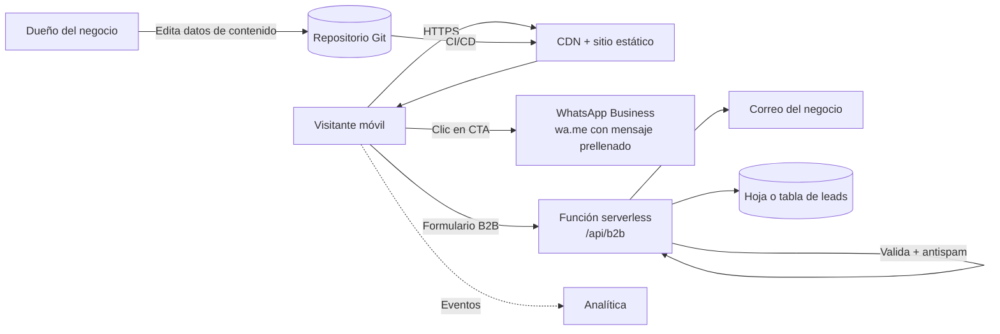
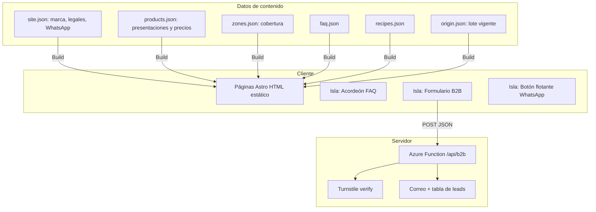
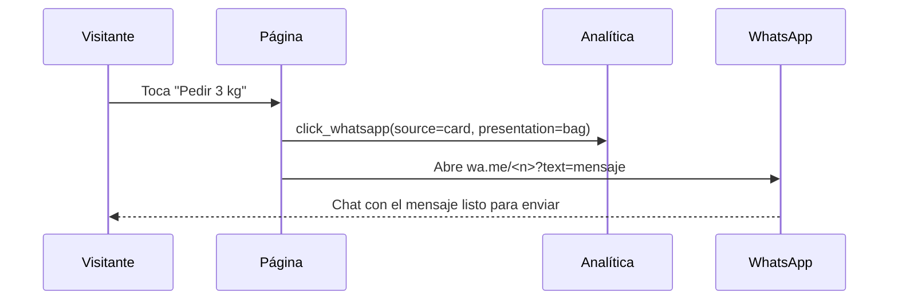

# Plan técnico: Landing Guineo Verde

**Versión:** 1.0 · **Fecha:** 2026-10-18 · **Estado:** Borrador

## Índice
1. Contexto arquitectónico
2. Decisiones técnicas (comparativa y recomendación)
3. Arquitectura
4. Estructura del repositorio
5. Modelo de datos de contenido
6. Contrato del endpoint B2B
7. Seguridad (controles trazables)
8. Rendimiento y SEO
9. Analítica
10. CI/CD y entornos
11. Riesgos y hallazgos
12. Matriz de trazabilidad

---

## 1. Contexto arquitectónico
**Técnico:** sitio mayormente estático, con una única función de servidor para el formulario B2B. Sin base de datos propia en la fase 1.
**Funcional:** pedir por WhatsApp (sin backend) y solicitar cotización B2B (con backend mínimo).



## 2. Decisiones técnicas

### D1. Framework

| Criterio | Astro | Next.js (SSG) | Angular SSR | Blazor WASM / SSR |
|---|---|---|---|---|
| JS enviado al cliente | Mínimo (islas) | Medio | Alto | Alto (WASM) o conexión persistente (SSR) |
| LCP en móvil 4G | Muy bueno | Bueno | Medio | Débil (WASM) |
| SEO estático | Excelente | Excelente | Bueno | Medio |
| Curva para tu perfil | Baja | Baja (ya usas React) | Nula (ya usas Angular) | Nula (.NET) |
| Idoneidad para landing | **Alta** | Media-alta | Baja | Baja |

**Recomendación: Astro + TypeScript + Tailwind CSS.** Una landing necesita poco JavaScript; Astro entrega HTML puro y solo hidrata los componentes interactivos (acordeón, formulario). Si prefieres seguir en React, Next.js con exportación estática es la alternativa razonable. Angular y Blazor agregan peso innecesario para este caso.

### D2. Hosting y backend del formulario

| Criterio | Azure Static Web Apps | Cloudflare Pages + Functions | Netlify |
|---|---|---|---|
| Familiaridad | **Alta (Azure)** | Media | Media |
| Funciones de servidor | Azure Functions gestionadas (C# o Node) | Workers / Pages Functions (JS/TS) | Functions (JS/TS) |
| Plan gratuito | Sí, con límites a verificar | Sí, generoso | Sí, con límites |
| CDN | Global | Global, muy extensa | Global |
| Integración con Azure DevOps | Directa | Vía pipeline | Vía pipeline |

**Recomendación: Azure Static Web Apps** con una Azure Function para `/api/b2b`, por afinidad con tu stack y para unificar operación. **Hipótesis a validar:** latencia desde Colombia y límites vigentes del plan gratuito. Si el rendimiento medido en Bogotá o Barranquilla es inferior, migrar a Cloudflare Pages es de bajo costo porque el sitio es estático.

### D3. Anti-spam
**Cloudflare Turnstile** (gratuito, sin acertijos) más campo trampa oculto y límite de frecuencia por IP. Alternativa: hCaptcha.

### D4. Almacenamiento de leads
Fase 1: correo transaccional al negocio (Resend, Azure Communication Services o SMTP) más fila en Azure Table Storage o Google Sheets. Evitar bases de datos relacionales en esta fase.

### D5. Analítica
**Plausible o Umami** (sin cookies, simple) como opción por defecto, que evita el banner de consentimiento. GA4 solo si se necesita integración con Google Ads, y entonces con banner de consentimiento.

### D6. Pedido en línea (fase 2)
No se implementa ahora. Cuando se aborde: pasarela Wompi o PayU, carrito mínimo y backend de pedidos. Queda registrado como evolución, no como parte de este plan.

## 3. Arquitectura



**Flujo del CTA de WhatsApp**



## 4. Estructura del repositorio

```
landing-guineo-verde/
├─ src/
│  ├─ components/        # Hero, TrustBar, ProductCards, Origin, Recipes, Faq, Coverage, B2BForm, Footer...
│  ├─ content/           # JSON editables: site, products, zones, faq, recipes, origin
│  ├─ layouts/
│  ├─ pages/             # index.astro, terminos.astro, privacidad.astro, garantia.astro
│  ├─ lib/               # whatsapp.ts, analytics.ts, schema.ts
│  └─ styles/
├─ api/                  # Azure Function b2b
├─ public/               # fuentes autoalojadas, favicon, robots.txt
├─ tests/                # e2e (Playwright) y unitarios
├─ specs/                # estos documentos
└─ .github o azure-pipelines.yml
```

## 5. Modelo de datos de contenido

```ts
// src/content/products.json (esquema)
type Presentation = {
  id: 'unit' | 'kg' | 'bag' | 'box';
  label: string;
  approxWeightG?: number;        // peso por unidad o total
  approxUnits?: string;          // "4–5"
  pricePerKg: number;            // COP
  priceTotal: number;            // COP
  cta: 'order' | 'quote';
  waMessage: string;             // plantilla con {presentation}
};

// src/content/site.json (esquema)
type Site = {
  brand: string;
  whatsapp: string;              // E.164 sin "+": 57XXXXXXXXXX
  legal: { razonSocial: string; nit: string; direccion: string; telefono: string; correo: string };
  sicUrl: string;                // enlace visible a la SIC
  cutoff: { hour: string; text: string };
  minOrder: number | null;
};
```

Los esquemas se validan en build (Zod). Un precio o dato legal faltante rompe la compilación, no la página en producción.

## 6. Contrato del endpoint B2B

`POST /api/b2b` · `Content-Type: application/json`

```json
{
  "name": "string 2-80",
  "business": "string 2-100",
  "phone": "string formato CO",
  "city": "string 2-80",
  "weeklyKg": 120,
  "consent": true,
  "turnstileToken": "string",
  "honeypot": ""
}
```

| Código | Cuándo |
|---|---|
| 200 | Recibido |
| 400 | Validación fallida (mensaje genérico, sin detalle interno) |
| 403 | Turnstile inválido |
| 429 | Exceso de solicitudes |
| 500 | Error interno (sin trazas hacia el cliente) |

**Reglas:** validar en servidor con la misma regla que el cliente, normalizar el teléfono, no registrar datos personales en logs, retener los leads solo el tiempo necesario y documentarlo en la política de privacidad.

## 7. Seguridad (controles trazables, ISO 27001 y OWASP)

| Riesgo | Control | Requisito |
|---|---|---|
| Inyección o XSS (A03) | Sin HTML dinámico no confiable, escape por defecto, CSP estricta | NFR-04 |
| Configuración insegura (A05) | Cabeceras HSTS, `X-Content-Type-Options`, `Referrer-Policy`, `Permissions-Policy` en `staticwebapp.config.json` | NFR-04 |
| Componentes vulnerables (A06) | `npm audit` y Dependabot en CI; versiones fijadas | NFR-04 |
| Fallas de autenticación en el formulario | Turnstile + límite de frecuencia | 4.2 de la spec |
| Fuga de secretos | Claves solo en variables del servidor; ninguna en el repositorio ni el cliente | P6 |
| Privacidad (Ley 1581) | Consentimiento explícito, aviso, mínimo de datos, retención definida | NFR-09 |
| Disponibilidad | Sitio estático en CDN | NFR-06 |
| Suplantación o falsificación de marca | Dominio propio con HTTPS, correo con SPF, DKIM y DMARC | P6 |

CSP de partida (ajustar a los servicios elegidos):
```
default-src 'self'; script-src 'self' https://challenges.cloudflare.com; img-src 'self' data:; style-src 'self' 'unsafe-inline'; connect-src 'self'; frame-src https://challenges.cloudflare.com; base-uri 'self'; form-action 'self'
```

## 8. Rendimiento y SEO

| Técnica | Detalle |
|---|---|
| HTML estático | Todo el contenido renderizado en build |
| Imágenes | AVIF/WebP, `srcset`, `width` y `height` explícitos, `loading="lazy"` fuera del primer viewport, imagen del hero con `fetchpriority="high"` |
| Fuentes | Autoalojadas, subconjunto latino, máximo 2 familias, `font-display: swap` |
| JavaScript | Solo islas: acordeón, formulario, botón flotante (hidratación `client:visible` o `client:idle`) |
| CSS | Tailwind con purga; CSS crítico en línea |
| Terceros | Máximo uno de analítica y Turnstile, cargados diferidos |
| SEO | Metadatos, Open Graph, JSON-LD (LocalBusiness, Product con Offer, FAQPage), `sitemap.xml`, `robots.txt` |
| Presupuesto | HTML+CSS+JS inicial ≤ 300 KB; imagen del hero ≤ 120 KB |

## 9. Analítica

| Evento | Parámetros | Disparador |
|---|---|---|
| `click_whatsapp` | `source` (hero, card, floating, footer, b2b), `presentation` | Clic en cualquier enlace a WhatsApp |
| `view_presentations` | – | La sección entra al 50 % del viewport |
| `submit_b2b` | `weeklyKg_range` | Respuesta 200 del endpoint |
| `open_faq` | `question_id` | Apertura de un ítem |
| `scroll_75` | – | 75 % de profundidad |

Los datos personales (nombre, teléfono) **nunca** viajan en eventos.

## 10. CI/CD y entornos

| Entorno | Rama | Propósito |
|---|---|---|
| Local | – | Desarrollo |
| Preview | Pull request | Revisión visual y pruebas e2e por cambio |
| Producción | `main` | Publicación tras aprobación |

**Pipeline:** instalar → validar esquemas de contenido → lint y tipos → pruebas unitarias → build → pruebas e2e (Playwright) → Lighthouse CI con umbrales → `npm audit` → despliegue.
**Umbrales de bloqueo:** Lighthouse móvil < 90 en cualquiera de las cuatro categorías, o vulnerabilidades altas o críticas.

## 11. Riesgos y hallazgos

| # | Riesgo | Probabilidad | Impacto | Mitigación |
|---|---|---|---|---|
| R1 | Prometer entrega que la operación no puede cumplir (perecedero, sin paquetería) | Alta | Alto | Definir Q5 antes de publicar; zonas limitadas; corte horario real |
| R2 | Precios desactualizados frente al mercado mayorista | Media | Medio | Precios en `products.json`; revisión semanal contra SIPSA |
| R3 | Afirmaciones de salud o ahorro sin respaldo | Media | Alto | Revisión de copy contra P1 y P3; lista legal |
| R4 | Sin testimonios reales al lanzar | Alta | Bajo | La sección no se publica hasta tener testimonios (AC-12) |
| R5 | Spam en el formulario B2B | Media | Bajo | Turnstile, honeypot, límite de frecuencia |
| R6 | Normativa citada en el informe sin validar | Media | Alto | Revisión de asesor jurídico antes del lanzamiento |
| R7 | Latencia desde Colombia en el hosting elegido | Baja-Media | Medio | Medir en preproducción; plan B Cloudflare Pages |
| R8 | Dependencia de WhatsApp como único canal de cierre | Media | Medio | Fase 2: pedido en línea; mientras tanto, teléfono visible como respaldo |

## 12. Matriz de trazabilidad

| Requisito | Componente / decisión | Tarea | Prueba |
|---|---|---|---|
| FR-01 | `TopBar`, `site.json` | T-12 | AC-01 (e2e) |
| FR-02 | `Hero` | T-13 | AC-01 |
| FR-03 | `TrustBar` | T-14 | Visual |
| FR-04 | `ProductCards`, `products.json`, `whatsapp.ts` | T-15, T-08 | AC-02, AC-03 |
| FR-05 | `FreshInfo` | T-16 | Visual |
| FR-06 | `Origin`, `origin.json` | T-17 | Visual |
| FR-07 | `Recipes`, `recipes.json` | T-18 | Visual |
| FR-08 | `Benefits` | T-46 | Revisión de copy (AC-08, P3) |
| FR-09 | `HowItWorks` | T-19 | Visual |
| FR-10 | `Coverage`, `zones.json` | T-20 | AC-04 |
| FR-11, 4.2 | `B2BForm`, `/api/b2b` | T-21, T-22 | AC-07 |
| FR-12 | `Testimonials` (condicional) | T-23 | AC-12 |
| FR-13 | `Faq`, JSON-LD | T-24 | AC-10 |
| FR-14 | `Guarantee` | T-25 | Visual |
| FR-15 | `FinalCta` | T-47 | Visual |
| FR-16, FR-18 | `Footer`, páginas legales | T-26, T-27 | AC-05, AC-06 |
| FR-17 | `FloatingWhatsApp` | T-28 | Visual móvil |
| FR-20 a FR-22 | `analytics.ts` | T-29 | AC-11 |
| NFR-01 a 03 | Optimización, SEO | T-30, T-31 | AC-09 |
| NFR-04 | Cabeceras, CSP | T-32 | Escaneo de cabeceras |
| NFR-09 | Aviso, consentimiento | T-27, T-22 | AC-07 |
